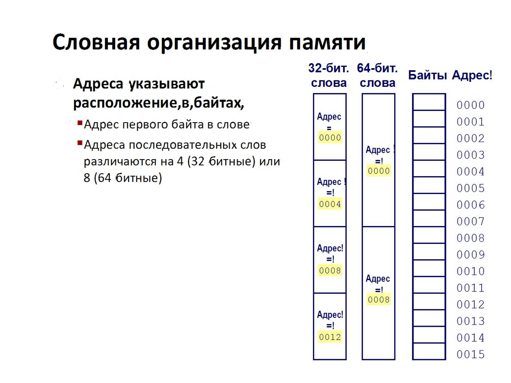
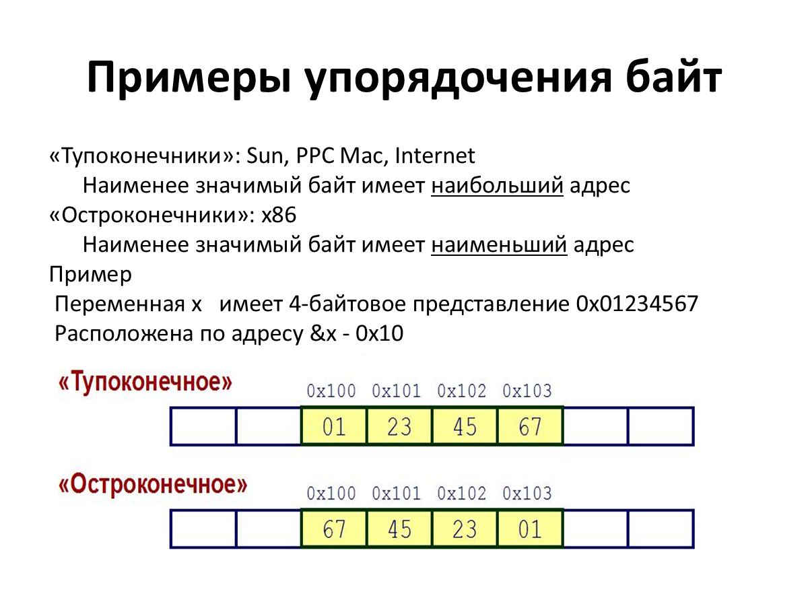
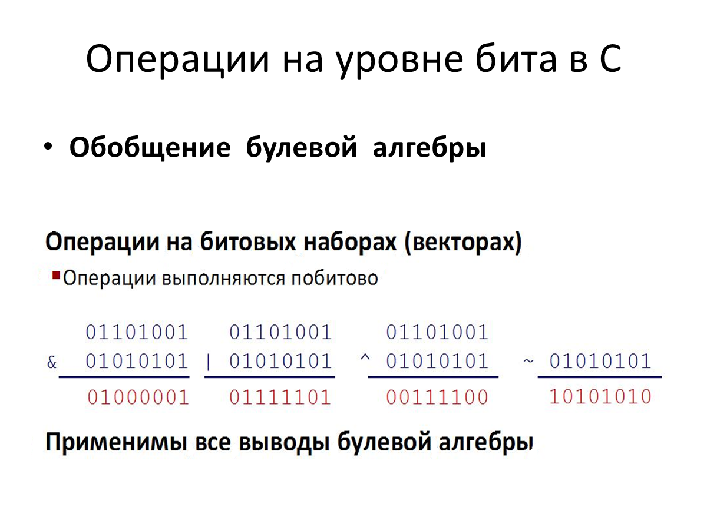
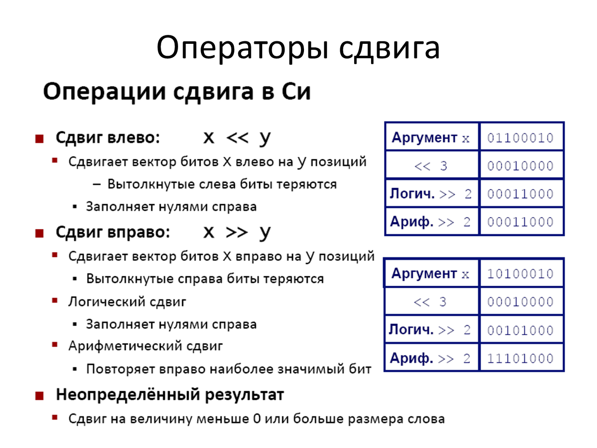
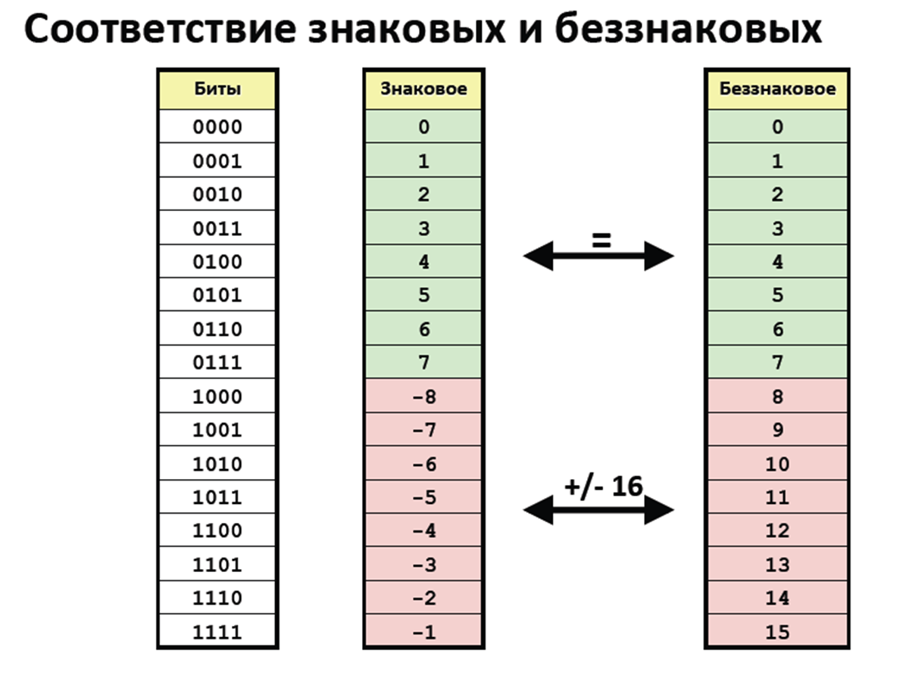
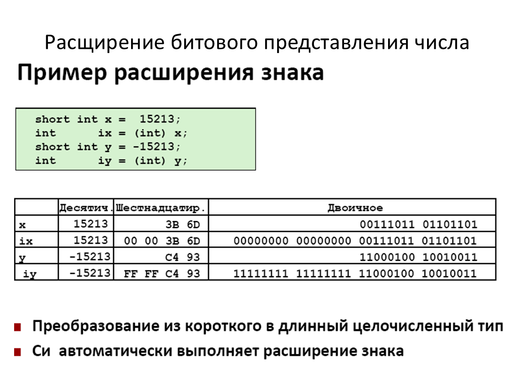
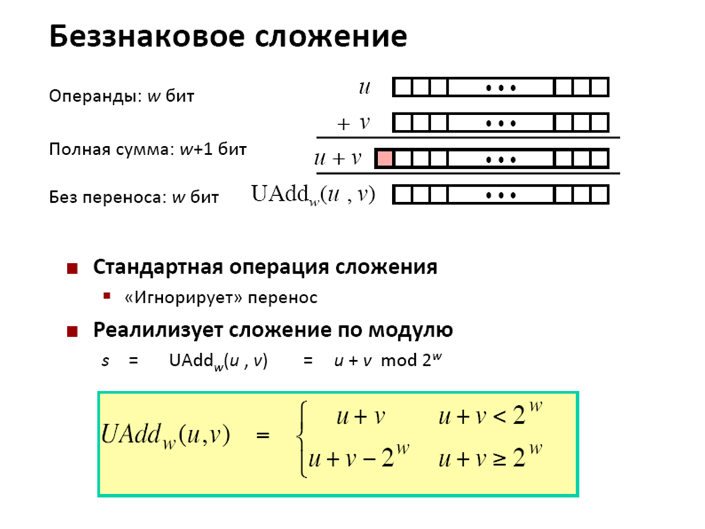

# Основы компьютера и кодирование данных

## Биты и байты

- **Бит** — минимальная единица данных со значением `0` или `1`. Из битов составляют коды команд, чисел, текстовых символов и наборов.
- В одном **байте** восемь бит, поэтому возможны 256 разных комбинаций. Беззнаковый байт представляет числа от `0` до `255`: от `00000000` до `11111111`, или от `00` до `FF` в hex.
- Шестнадцатеричная запись использует цифры `0–9` и буквы `A–F`. Один hex-разряд кодирует четыре бита, а байт записывают двумя разрядами. В языке C перед числом ставят `0x`.
- Таблица **ASCII** задаёт числовой код для каждого поддерживаемого символа.

## Память и машинное слово

- Память можно представить как последовательность байтов, каждому из которых назначен адрес. Операционная система обычно изолирует процессы отдельными виртуальными адресными пространствами.
- **Машинное слово** — привычная для архитектуры ширина целых значений и адресов. Распространены слова длиной 32 бита (4 байта) и 64 бита (8 байт).
- При 32-битной адресации доступно до 4 ГБ адресного пространства.
- Адрес слова совпадает с адресом его младшего по адресу байта; следующее слово начинается через 4 или 8 байт.
- Размеры типов C определяются платформой. В приведённых примерах `char` занимает 1 байт, `short` — 2, `int` — 4, `long long` — 8, `float` — 4, `double` — 8 байт. Ширина `long` и указателя может различаться.

## Порядок байтов

Порядок байтов определяет, какая часть многобайтового значения размещается по младшему адресу. Для `0x01234567` адреса возрастают слева направо:

- **«Тупоконечный» порядок:** старший байт первым — `01 23 45 67`.
- **«Остроконечный» порядок (x86):** младший байт первым — `67 45 23 01`.

От выбранного порядка зависит интерпретация последовательности байтов при чтении памяти и инструкций. **Дизассемблер** преобразует машинный код в его текстовую форму.

## Булева алгебра и операции в Си

Булевы значения представляют единицей для истины и нулём для лжи. Побитовые операторы обрабатывают соответствующие разряды целых чисел независимо друг от друга:

| Операция | Оператор | Когда результат равен 1 |
| --- | --- | --- |
| И | `&` | Оба бита равны 1 |
| ИЛИ | `\|` | Хотя бы один бит равен 1 |
| Исключающее ИЛИ | `^` | Биты различаются |
| НЕ | `~` | Исходный бит равен 0 |

Набор битов можно трактовать как множество: единичный бит с номером `i` означает, что элемент `i` включён. В такой записи `&` вычисляет пересечение, `|` — объединение, `^` — симметрическую разность, а `~` — дополнение.

**Логические операторы** `&&`, `||`, `!` проверяют значения целиком. Ноль считается ложью, любое ненулевое значение — истиной; результатом служит `0` либо `1`. Для `&&` и `||` вычисление может завершиться раньше, если ответ уже однозначен.

## Сдвиги

- Операция `x << y` перемещает разряды влево на `y` позиций и заполняет освободившиеся справа места нулями.
- При `x >> y` разряды смещаются вправо. **Логический сдвиг** вставляет слева нули, а **арифметический** копирует туда знаковый разряд.
- Разряды, вышедшие за пределы ширины значения, отбрасываются.

## Целые числа и дополнительный код

Для числа длиной **w бит**:

| Представление | Диапазон | Пример для 8 бит |
| --- | --- | --- |
| Без знака | от 0 до 2^w − 1 | 0…255 |
| Со знаком, дополнительный код | от −2^(w−1) до 2^(w−1) − 1 | −128…127 |

- Для дополнительного кода старший разряд имеет вес `−2^(w−1)`. Если он равен нулю, число неотрицательное; если единице — отрицательное.
- Код числа с противоположным знаком получают побитовой инверсией и прибавлением единицы, ограничиваясь выбранными `w` разрядами: `~x + 1`.
- Одна битовая последовательность допускает разные интерпретации: `11111111` означает `255` как unsigned и `−1` как signed в дополнительном коде.
- Диапазон содержит на одно отрицательное значение больше, чем положительных. В C границы целочисленных типов доступны через `<limits.h>`.

## Преобразования целых чисел

- При одинаковой ширине знаковое и беззнаковое прочтение сохраняет биты, но численное значение отличается на `2^w`.
- В смешанном выражении `int` с `unsigned int` знаковое значение приводится к беззнаковому типу. Поэтому `−1 < 0` истинно, тогда как `−1 < 0U` — ложно.
- **Расширение разрядности** добавляет слева нули для unsigned или копии знакового бита для signed, сохраняя значение.
- **Сужение разрядности** удаляет старшие биты; оставшаяся последовательность интерпретируется по новому типу и может дать другое значение.

## Сложение и переполнение

- Для хранения точной суммы двух `w`-разрядных чисел в общем случае нужен дополнительный разряд.
- Для unsigned перенос за старший разряд игнорируется, поэтому итог равен `(u + v) mod 2^w`.
- При сложении чисел в дополнительном коде применяется та же двоичная операция, после чего результат читают по его младшим `w` битам как signed-число.
- Если точная сумма не укладывается в диапазон, происходит **переполнение**. В описываемой модели результат оборачивается по модулю `2^w`, что может изменить знак.
- Сложение по модулю обладает коммутативностью и ассоциативностью, ноль является нейтральным элементом, а для каждого значения существует обратное.

