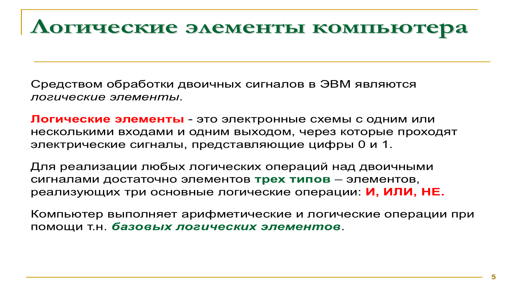
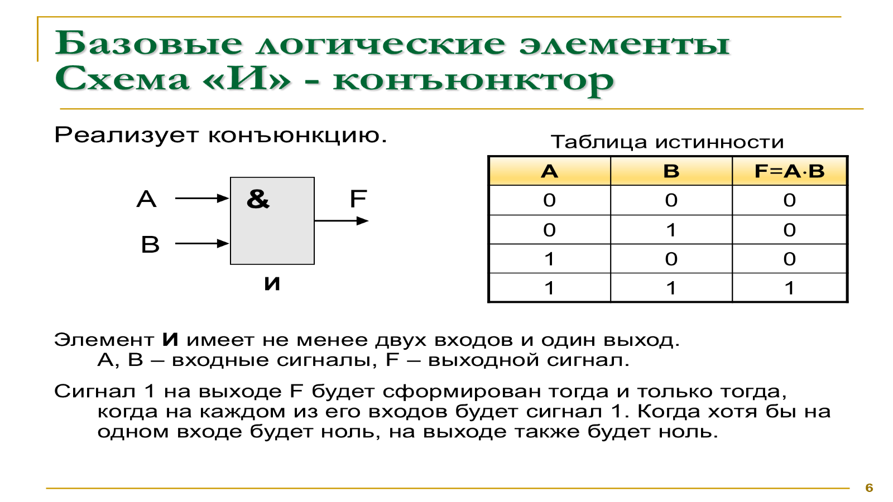
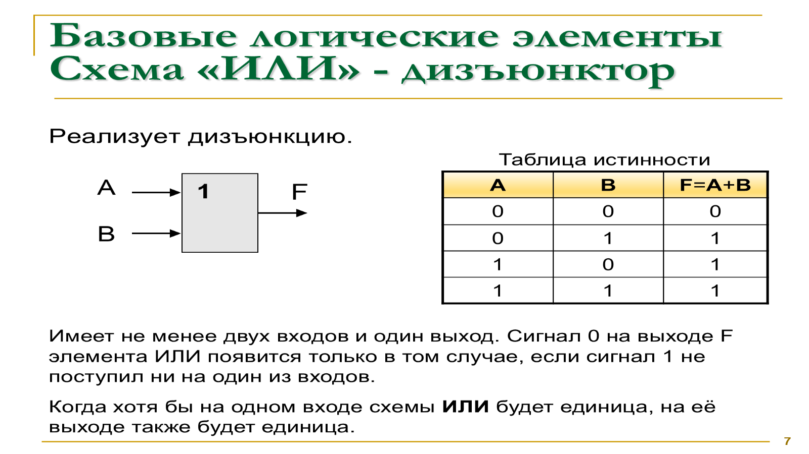
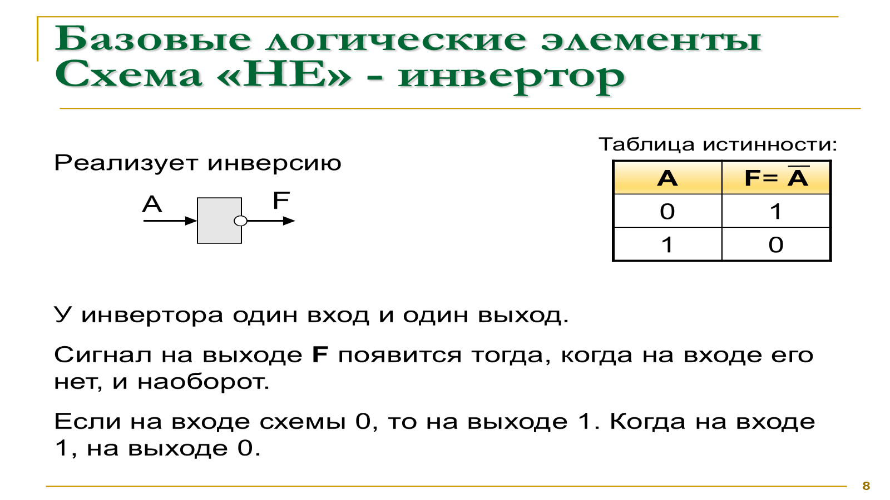
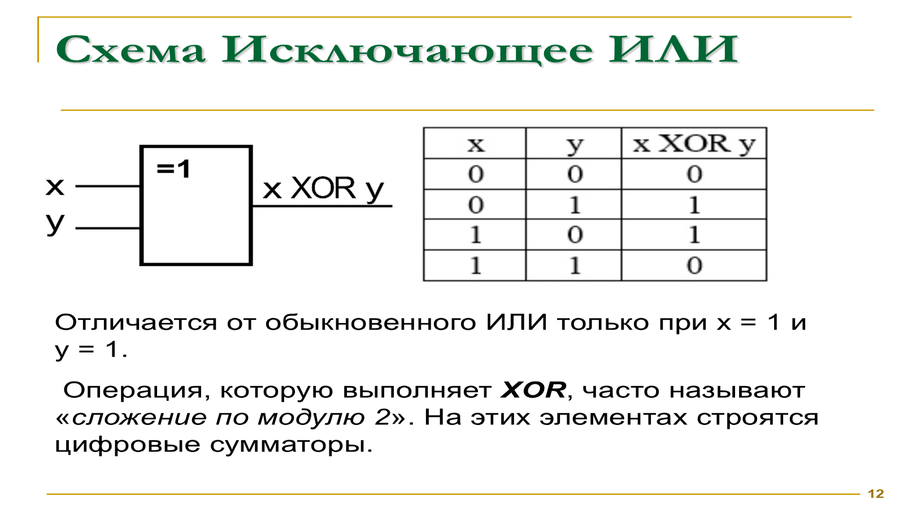
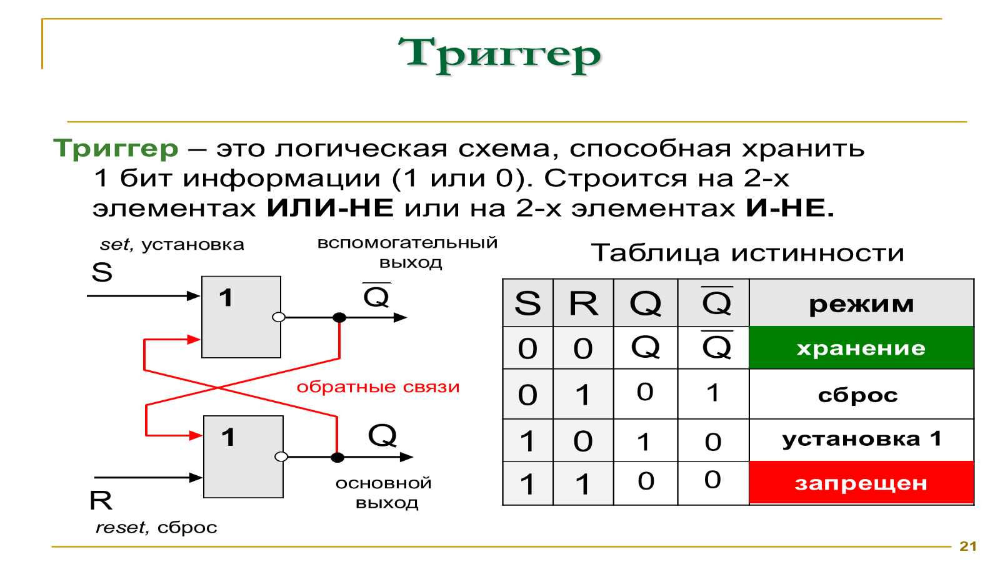
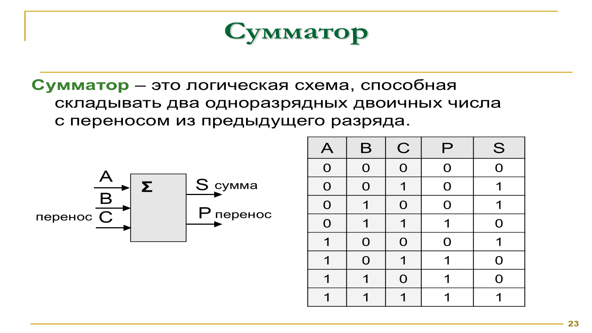
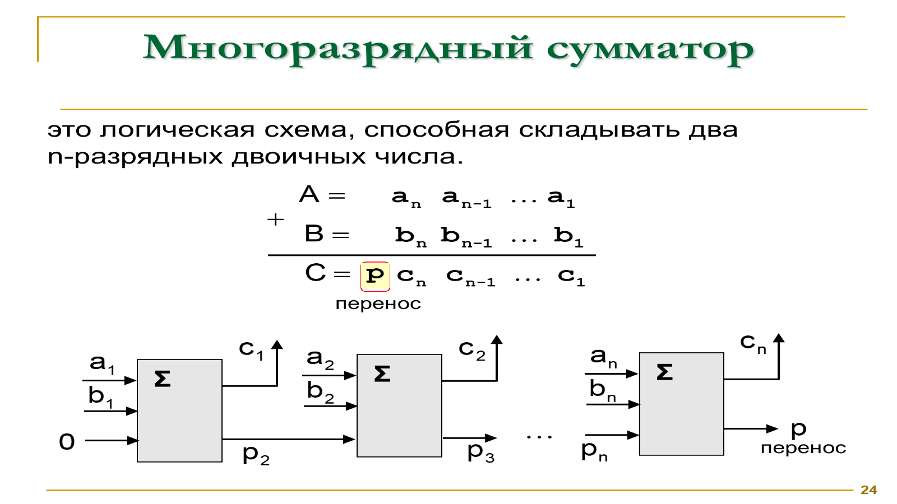
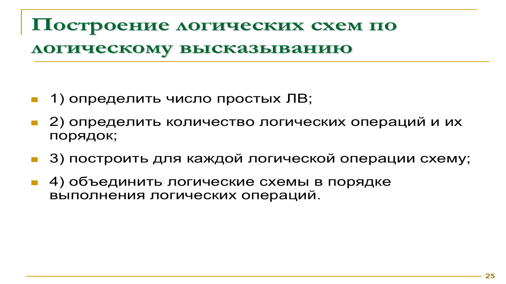

# Цифровая логика и двоичное сложение

## Логические основы компьютера

- Информация в компьютере представлена двоичными последовательностями, из которых кодируют числа и текст.
- В электронной схеме высокий сигнал обычно трактуется как `1`, а низкий или отсутствующий — как `0`.
- Чарльз Пирс обратил внимание на то, что двоичные логические операции можно воплотить переключателями.
- Клод Шеннон формально связал булеву алгебру с релейными цепями и двоичным представлением. Эти идеи лежат в основе цифровой техники.

## Логические элементы

**Логический элемент** принимает один или несколько двоичных сигналов и выдаёт результат согласно таблице истинности.

Комбинаций трёх базовых элементов — **И**, **ИЛИ**, **НЕ** — достаточно для построения любых булевых выражений.

### И (конъюнктор)

У элемента И два или более входа. Единичный выход появляется лишь тогда, когда единицами являются все входные сигналы.

| A | B | A И B |
| --- | --- | --- |
| 0 | 0 | 0 |
| 0 | 1 | 0 |
| 1 | 0 | 0 |
| 1 | 1 | 1 |

### ИЛИ (дизъюнктор)

ИЛИ выдаёт единицу, когда единичен хотя бы один вход. Нулевой результат возможен только при нулевых значениях всех входов.

| A | B | A ИЛИ B |
| --- | --- | --- |
| 0 | 0 | 0 |
| 0 | 1 | 1 |
| 1 | 0 | 1 |
| 1 | 1 | 1 |

### НЕ (инвертор)

Элемент НЕ имеет единственный вход и инвертирует его: ноль превращается в единицу, а единица — в ноль.

| A | НЕ A |
| --- | --- |
| 0 | 1 |
| 1 | 0 |

## Комбинированные элементы

- **И-НЕ** инвертирует выход элемента И.
- **ИЛИ-НЕ** даёт инверсию результата ИЛИ.
- **Исключающее ИЛИ (XOR)** становится равным `1`, если два входных бита не совпадают; это также сложение по модулю 2.

| A | B | A XOR B |
| --- | --- | --- |
| 0 | 0 | 0 |
| 0 | 1 | 1 |
| 1 | 0 | 1 |
| 1 | 1 | 0 |

Сочетая базовые элементы, можно реализовать произвольную логику и более сложные узлы: триггеры, сумматоры, регистры, счётчики, кодировщики и дешифраторы.

## Триггер

**Триггер** — схема памяти на один бит с двумя устойчивыми состояниями: нулевым и единичным.

- Его можно собрать, например, из пары элементов ИЛИ-НЕ либо И-НЕ.
- Сигнал `S` задаёт состояние «1», а `R` сбрасывает его.
- Благодаря обратным связям схема удерживает записанное состояние после изменения входов.
- Несколько триггеров объединяют в регистры и другие запоминающие узлы.

## Сумматор

**Сумматор** выполняет двоичное сложение и служит одним из основных узлов арифметики процессора.

Полный одноразрядный блок принимает два бита и перенос от предыдущего разряда, а формирует бит суммы и перенос дальше.

Для сложения двух `n`-разрядных чисел одноразрядные блоки соединяют цепочкой: перенос с каждого разряда служит входом следующего.

## Построение логической схемы

Схему по формуле строят в таком порядке:

1. Выписать все переменные, поступающие на вход.
2. Разобрать операции и определить их приоритет.
3. Для каждой операции выбрать соответствующий логический элемент.
4. Соединить элементы так, чтобы сигнал проходил в порядке вычисления.

При обратном разборе схемы прослеживают сигнал от входов к выходу и последовательно записывают выражение каждого узла.

