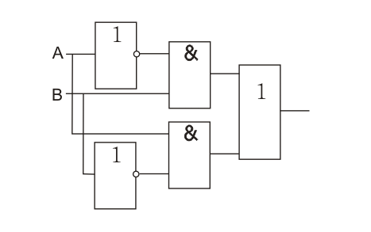
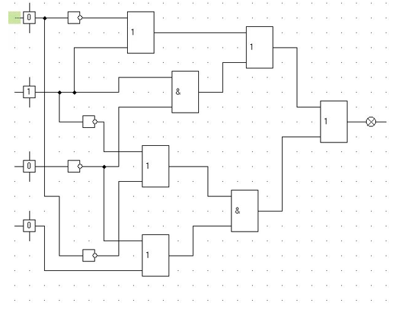
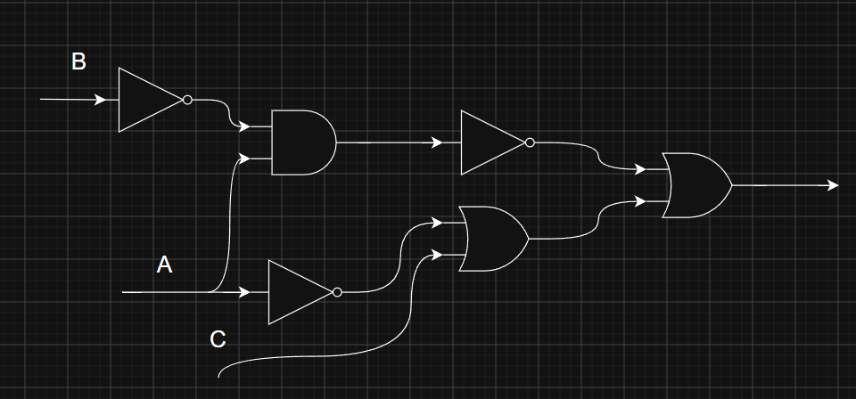
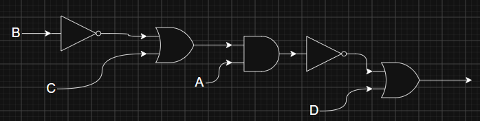

# Практика по логическим выражениям и схемам

## Что надо было сделать

### Часть 1. Запись формул по схемам

### Часть 2. Построение схем по формулам

- (A ∧ ¬B) → (C ∨ ¬A)

- ¬(A ∧ (B → C)) ∨ D

## Разбор решений

### 1 Часть

- **Первая схема.** Выход выражается как:
    **`(¬A ∧ B) ∨ (A ∧ ¬B)`**.

- **Вторая схема.** Если подписать входы сверху вниз буквами `A`, `B`, `C`, `D`, получим:
    **`((¬A ∨ B) ∨ (B ∧ ¬C)) ∨ ((¬B ∨ ¬A) ∧ (¬C ∨ D))`**;

### 2 Часть

- **Первая формула:**
    **`(A ∧ ¬B) → (C ∨ ¬A)`**

- **Вторая формула:**
    **`¬(A ∧ (B → C)) ∨ D`** 

