# Как устроен процессор

Краткая систематизация тем о внутренних узлах процессора, управлении командами и архитектурах системы команд.

## Элементы процессора

Основные элементы процессора:

- **Дешифратор команд** интерпретирует код операции.
- **Операционные блоки**, включая арифметико-логическое устройство (АЛУ), обрабатывают значения.
- **Устройство управления (УУ)** вырабатывает сигналы и координирует работу узлов.
- В **регистрах** временно размещаются данные, адреса и результаты.
- **Узел формирования адреса операнда** помогает определить, где находятся данные.
- **Шины** обеспечивают обмен сигналами и данными между компонентами.

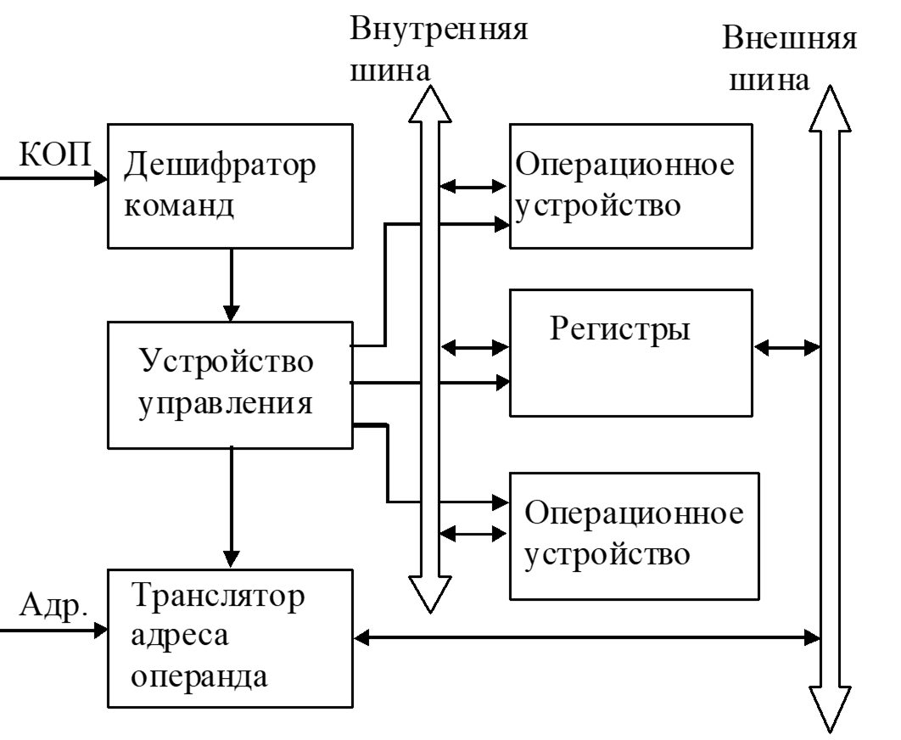

Связь процессора с остальной системой организована адресными, информационными и управляющими линиями. Для работы также подаются питание и тактовый сигнал; внешние устройства могут запрашивать обслуживание прерыванием.

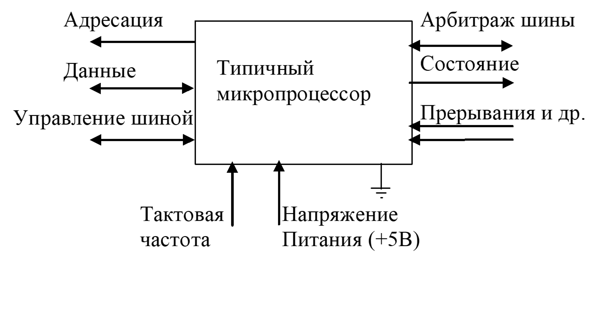

Исторический пример из материала — микропроцессор Intel 4004, выпущенный в 1971 году.

## Операционные устройства

В зависимости от назначения операционные блоки выполняют целочисленную и логическую обработку, десятичную арифметику, сдвиги, вычисления с плавающей точкой и графические операции.

Типовой операционный блок включает три основные составляющие:

- регистры, в которых размещаются обрабатываемые слова;
- шины, по которым значения передаются между регистрами;
- комбинационную логику, выполняющую выбранное действие под управлением УУ.

### Регистры

**Регистр** хранит двоичное слово и физически строится из триггеров, по одному на каждый бит.

По доступности и назначению регистры подразделяются на:

- непосредственно доступные программному коду;
- косвенно доступные, например теневые регистры дескрипторов сегментов;
- служебные внутренние, в частности регистры адреса и данных памяти;
- внутренние временные регистры, сохраняющие промежуточные значения.

В приведённой схеме данные идут из регистра-источника к регистру-приёмнику через вентили. Разрешающий строб определяет момент передачи.

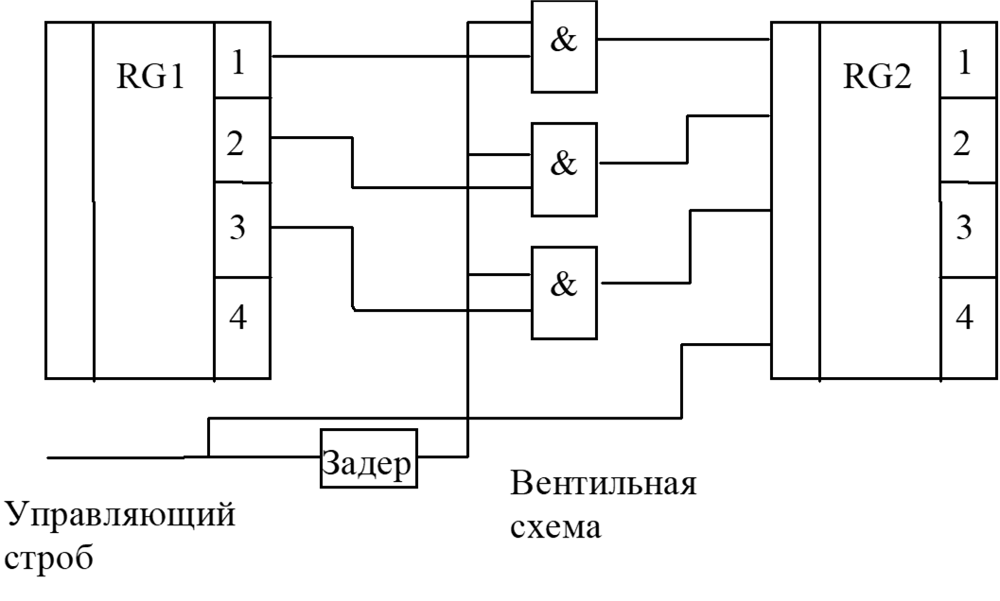

### Мультиплексор

Мультиплексор выбирает один из источников для дальнейшей передачи. На схеме также показаны входные вентили и строб, задающий, когда регистр-приёмник должен обновить значение.

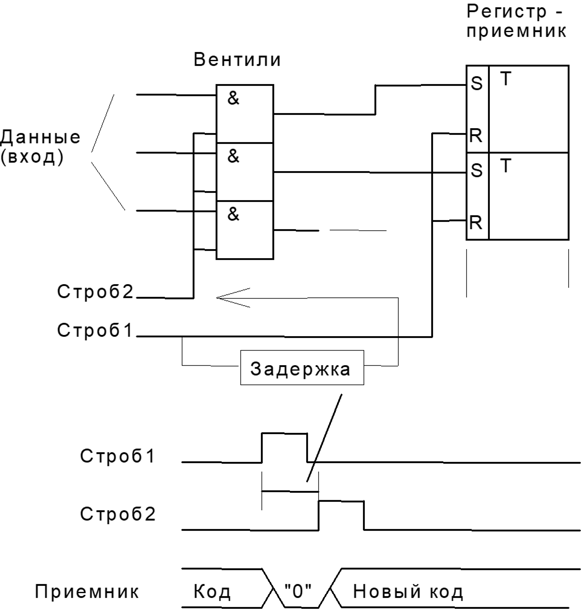

### Арифметико-логическое устройство

**АЛУ** получает пару операндов и выдаёт результат операции, указанной управляющим кодом. В этой модели оно комбинационное и не хранит состояние.

Именно код операции выбирает, какой из вычисленных вариантов направить на выход.

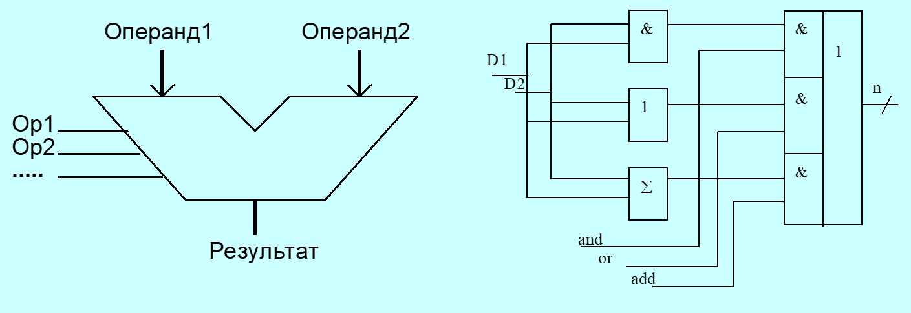

На принципиальной схеме АЛУ объединены логический блок, полный сумматор и дешифратор, который распознаёт требуемое действие.

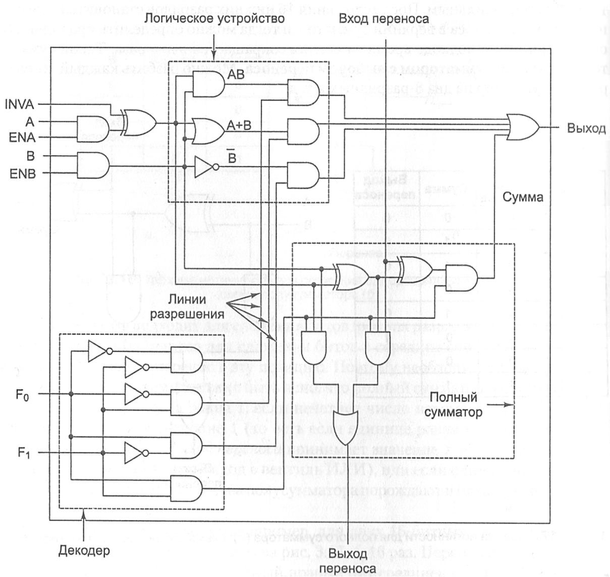

Восьмибитовый вариант собирают из восьми одноразрядных секций, соединяя выход переноса каждой секции со входом следующей.

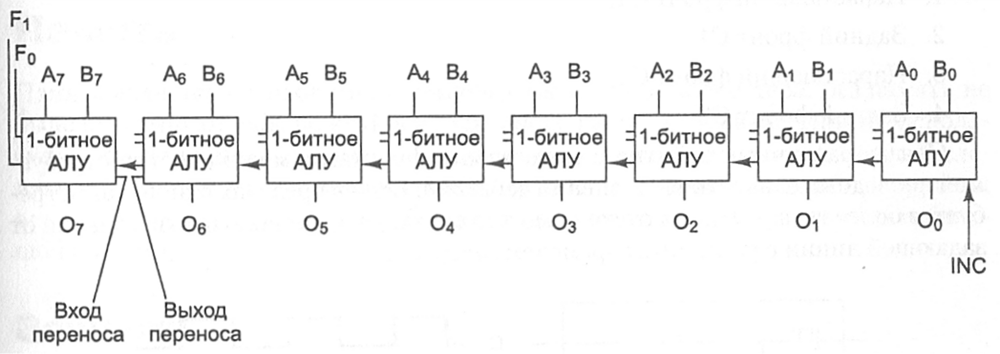

### Простейшие операции

В презентации показаны три примера:

| Команда | Действие |
| --- | --- |
| `mov R1, R2` | Пересылка данных между регистрами |
| `rol R0` | Циклический сдвиг содержимого регистра |
| `add R0, R1` | Сложение операндов |

При сложении операнды подаются на входы АЛУ, результат вычисления сохраняется в регистре, а нужную последовательность действий задают сигналы управления в отдельных тактах.

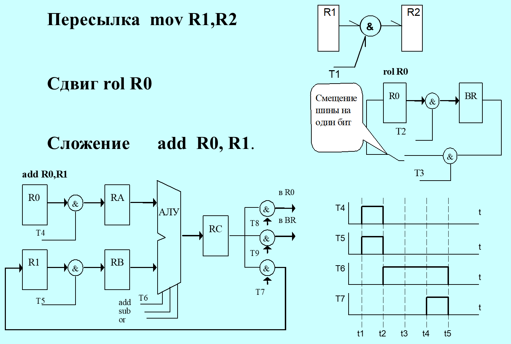

## Связь операционных устройств с шинами

Тракт данных фон Неймана показывает, как два значения из регистров поступают во входные регистры АЛУ, а полученный результат через выходной регистр возвращается в регистровый набор.

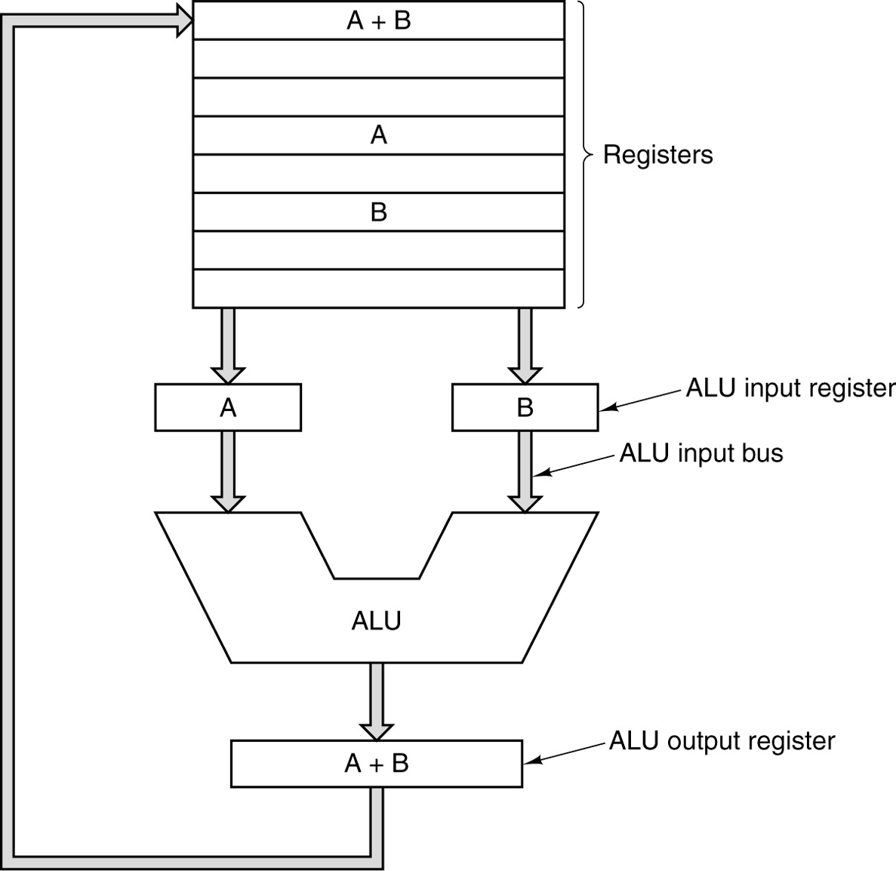

В магистральной организации устройства разделяют общие линии передачи. Источники подключаются через мультиплексоры, а направление записи результата задаёт демультиплексор.

**РОН** — регистры общего назначения. **ОПБ** — операционный блок.

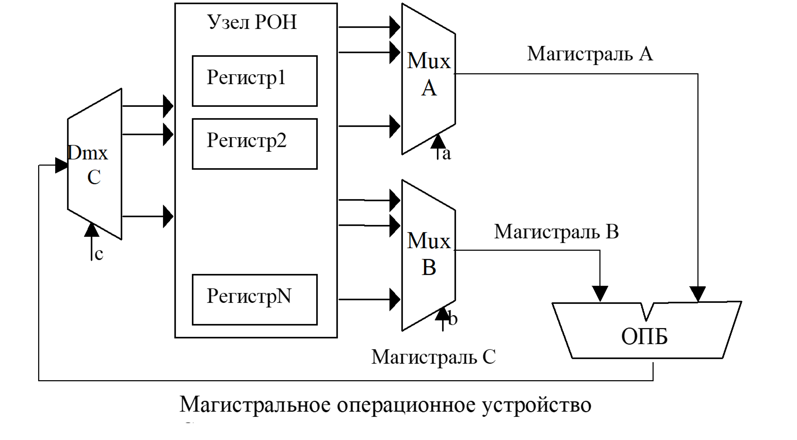

Операционные устройства строят с одной, двумя или тремя магистралями. Если шин меньше, промежуточные значения приходится временно удерживать в буферных регистрах (БР).

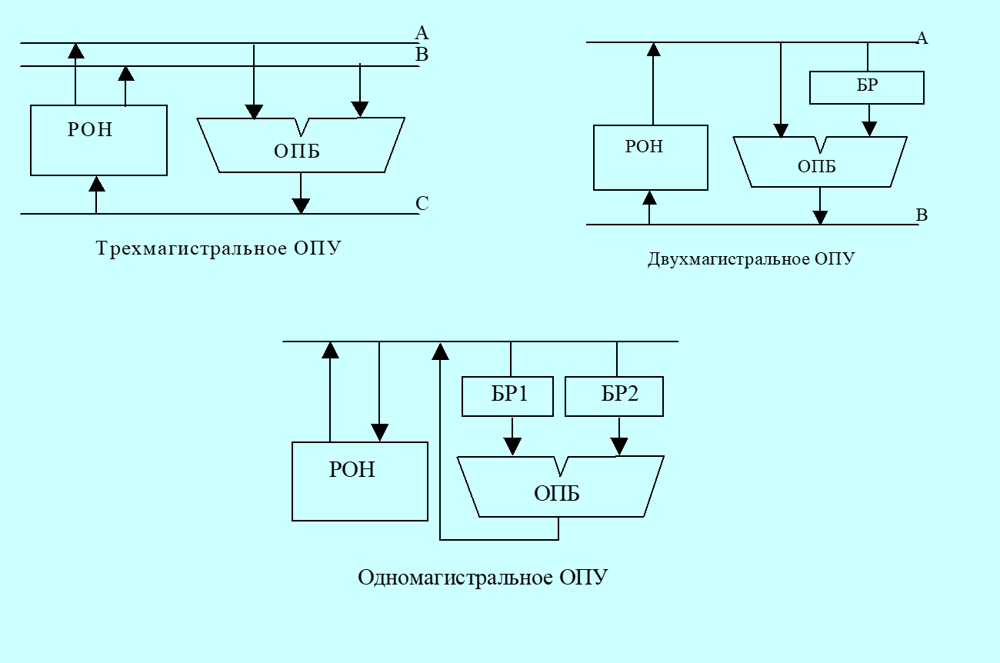

## Устройство управления

УУ организует автоматическое прохождение команд и вырабатывает сигналы, необходимые для следующих действий:

1. Выборки очередной команды из оперативной памяти.
2. Дешифрации кода операции.
3. Формирования адресов операндов.
4. Выборки операндов из памяти.
5. Передачи операндов в операционное устройство.
6. Выполнения операции.
7. Передачи результата в память.
8. Ввода и вывода.
9. Реакции на запросы прерывания.

### Микрооперация, микрокоманда и микропрограмма

- **Микрооперация** — простейшее действие, занимающее один такт.
- **Микрокоманда** объединяет микрооперации, которые могут выполняться параллельно.
- **Микропрограмма** задаёт последовательность микрокоманд для реализации машинной команды.
- **Микропрограммный автомат** формирует управляющие сигналы, учитывая код команды, флаги и тактовую последовательность.

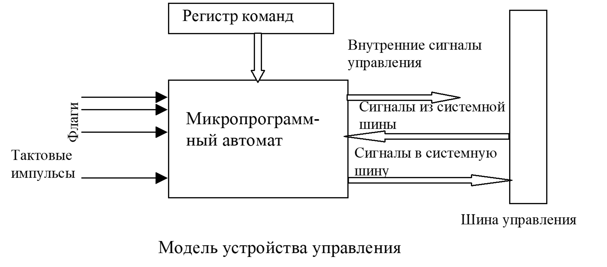

В составе устройства управления выделяются два функциональных узла.

| Часть | Назначение | Состав |
| --- | --- | --- |
| Управляющая | Вырабатывает последовательность микрокоманд | Регистр команды, микропрограммный автомат и дешифратор команд, узел прерываний и приоритетов |
| Адресная | Формирует адреса команд и операндов | Операционный узел УУ, регистр адреса, счётчик команд |

### Автомат с жёсткой логикой

В автомате с жёсткой логикой сигналы задаются комбинацией аппаратно соединённых схем. При их формировании учитываются:

- код операции;
- номер текущего такта;
- флаги.

Длительность команд различается: для каждого такта формируется собственная микрокоманда. По завершении команды счётчик переводится обратно в исходное состояние `T1`.

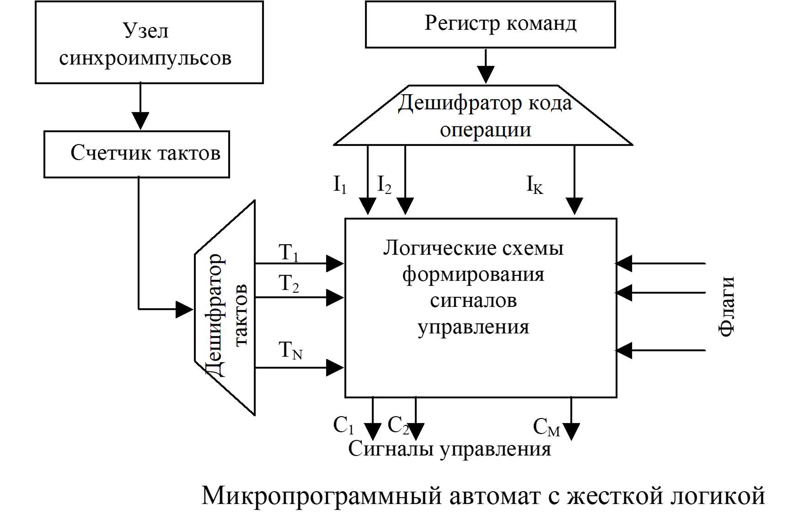

### Автомат с программируемой логикой

Ключевой компонент автомата с программируемой логикой — **память микропрограмм**, где для каждой машинной команды хранится соответствующая последовательность микрокоманд.

По коду операции выбирается адрес начала нужной последовательности. Очередная микрокоманда считывается из памяти и преобразуется дешифратором в сигналы управления; затем рассчитывается адрес следующего шага.

Концепцию микропрограммного управления Морис Уилкс предложил в 1951 году.

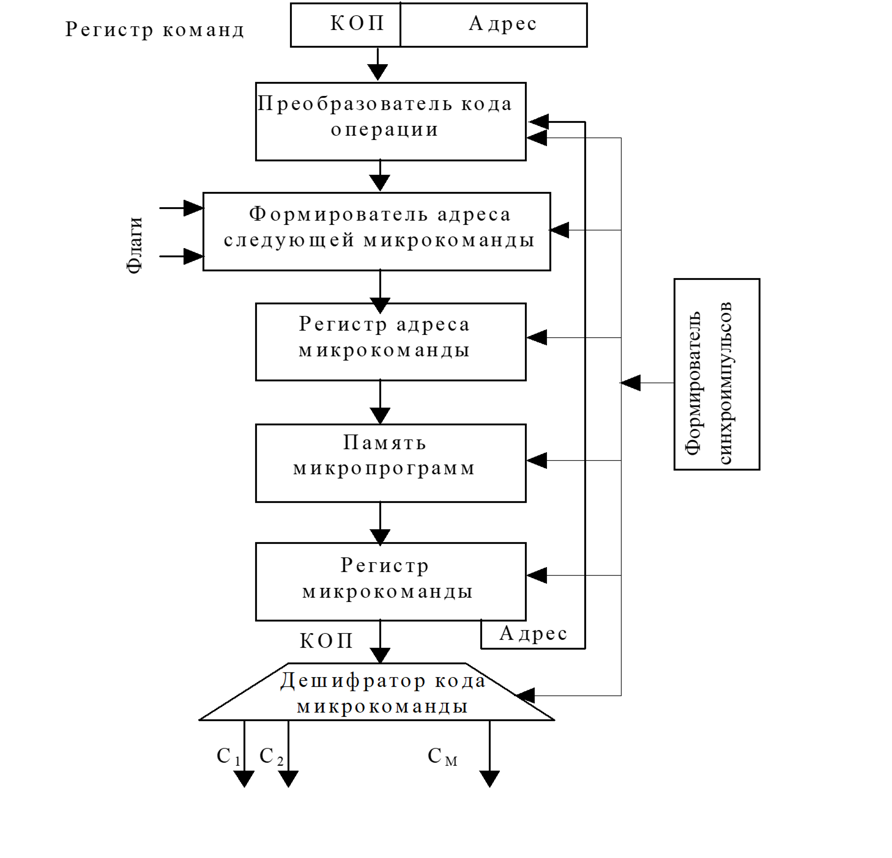

### Пример процессора с тремя шинами

Для этого примера описаны два типа микрокоманд:

- **GATE**: отдельные биты включают соответствующие управляющие вентили.
- **TEST**: формат задаёт регистр, номер бита, ожидаемое значение `0` или `1` и адрес перехода.

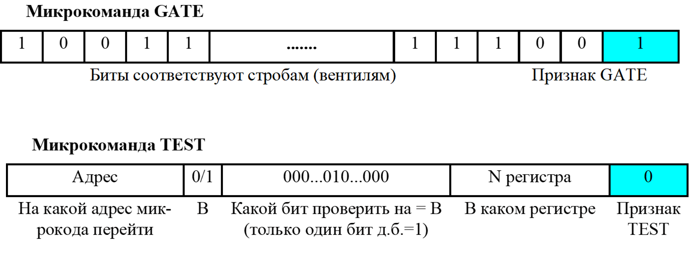

Далее сопоставлены одноуровневое и двухуровневое хранение микропрограмм. Во втором случае микропамять содержит коды, по которым выбираются записи нанопамяти.

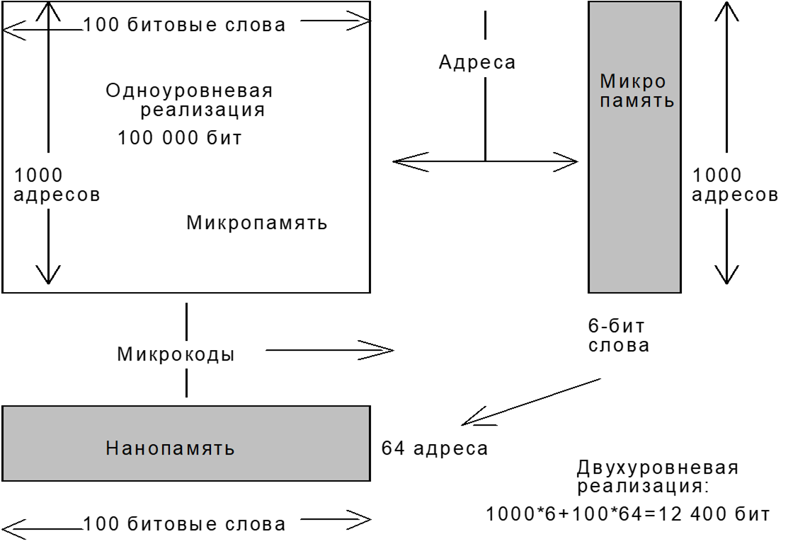

Внутри процессора шины `AB` и `BB` подводят операнды к сумматору, а по `CB` передаётся результат. Управляемые вентили выбирают источник на каждой шине; кроме того, тракт содержит инверторы и устройство сдвига.

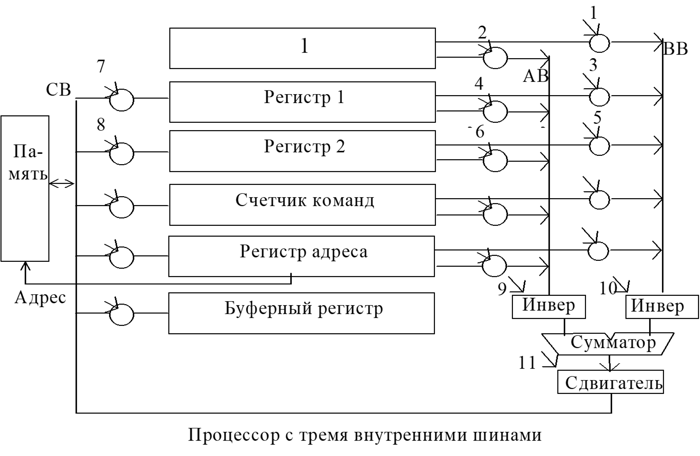

На схеме перечислены комбинации вентилей для сложения и инверсии. Например, при сложении сначала открывают вентили 3 и 6, после чего включают запись: вентиль 7 направляет результат в регистр 1, а вентиль 8 — в регистр 2.

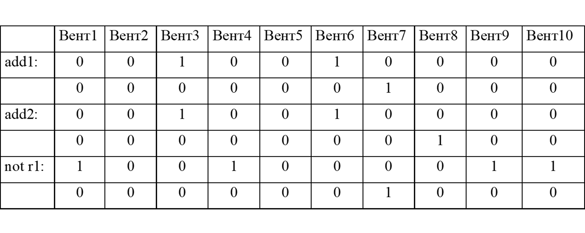

## Архитектуры системы команд

Один из способов классифицировать процессоры — определить, где хранятся операнды и каким способом команда получает их для обработки.

### Стековая архитектура

Стек — структура **LIFO**: последним добавленный элемент извлекается первым.

Основные операции:

- `push` — поместить данные на вершину стека;
- `pop` — извлечь данные с вершины стека.

Так как обращаться нужно только к вершине, стековая модель упрощает указание операндов. Стек реализуют программно в памяти либо аппаратно; один из вариантов аппаратного устройства — цепочка регистров сдвига.

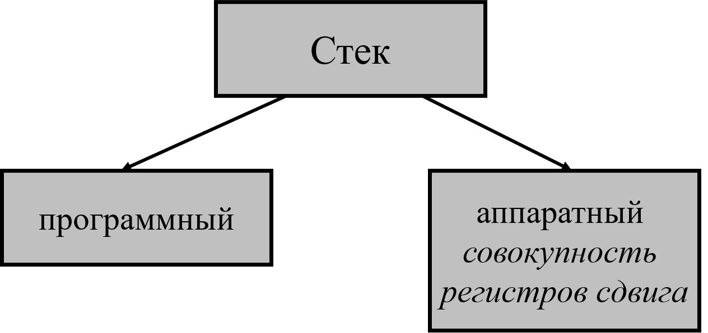

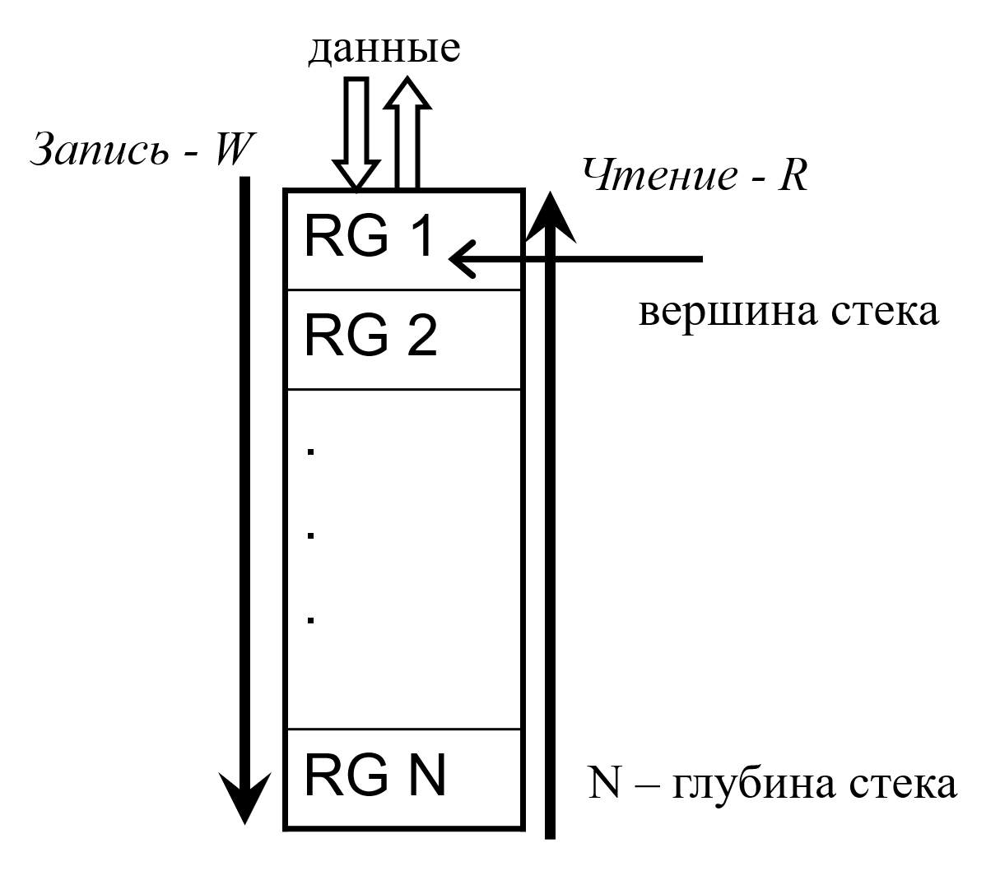

В стековых вычислениях удобно применять **обратную польскую запись**: оператор следует за своими операндами, поэтому расставлять скобки не требуется.

Пример из презентации:

    a = a + b + a × c
    a = a b + a c × +

### Аккумуляторная архитектура

В аккумуляторной модели специальный регистр-**аккумулятор** содержит один операнд, а затем принимает итог вычисления.

Другой операнд команда берёт из памяти; после обработки новое значение остаётся в аккумуляторе.

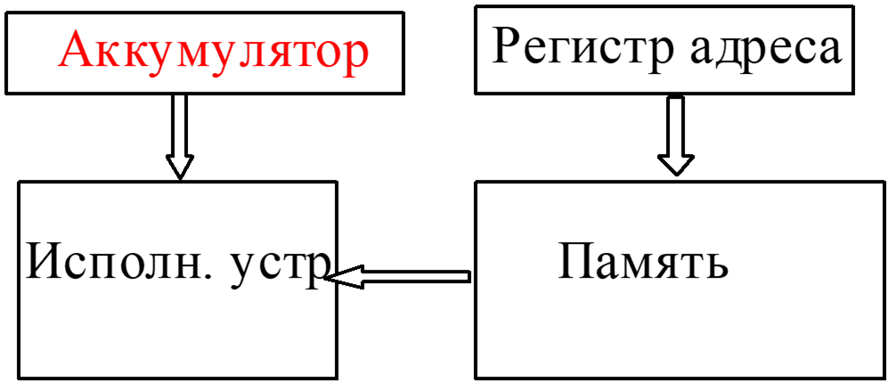

- Команда `load x` читает ячейку `x` в аккумулятор.
- Команда `store x` переносит значение аккумулятора в ячейку `x`.

Такая организация позволяет использовать короткие команды и несложный декодер. Однако единственный рабочий регистр приводит к частым обращениям к памяти.

### Регистровая архитектура

**Регистровый файл** — группа регистров общего назначения, выбираемых по номеру.

Обычно ширина регистра соответствует машинному слову. Размещение часто используемых значений внутри процессора сокращает обращения к памяти.

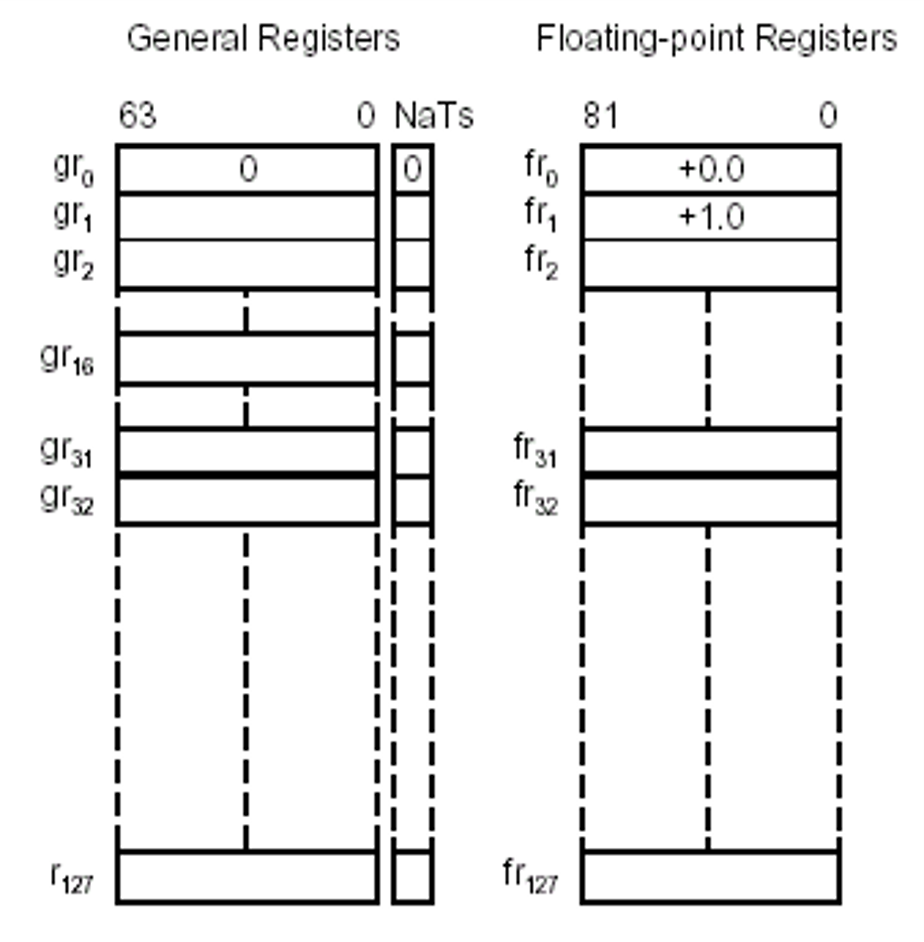

Операнды команд обработки могут располагаться в разных местах:

- регистр — регистр;
- регистр — память;
- память — память.

Доступ к регистрам даёт быстрые операции и помогает уплотнить программу, хотя формат команды обычно сложнее, чем в аккумуляторной архитектуре.

В материале также отмечено, что в RISC-процессорах обычно предусмотрено больше РОН, чем в CISC.

### Архитектура с выделенным доступом к памяти

Память используется только специальными командами двух типов:

- `load` переносит данные из памяти в регистр;
- `store` сохраняет содержимое регистра в памяти.

Остальные вычислительные команды работают только с регистрами: читают регистровые операнды и сохраняют результат обратно в регистр.

Подобная схема используется в рассмотренных RISC-архитектурах, например SPARC, MIPS, DEC Alpha и PowerPC.

Сводная иллюстрация сопоставляет CISC с широким набором инструкций, RISC с упрощённой системой команд и VLIW, где одна команда содержит несколько операций.

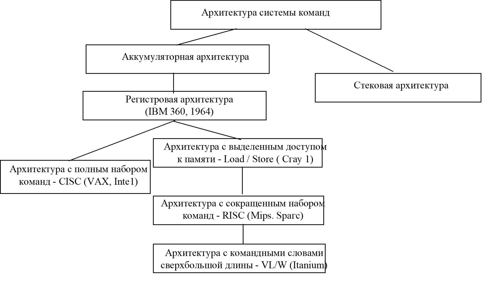

### Конфигурируемые процессоры

В качестве настраиваемой платформы упоминаются ядра **Xtensa** компании Tensilica и инструмент **Xenergy**. Они позволяют подбирать конфигурацию ядра, расширять систему команд и набор регистров, а затем оценивать энергопотребление ядра и памяти.

## Intel 8086: структура и регистры

На блок-схеме Intel 8086 показаны два крупных узла: блок обработки данных и блок обмена с системной шиной.

В состав схемы входят:

- регистры данных и адресов `AX, BX, CX, DX, SI, DI, SP, BP`;
- сегментные регистры `CS, SS, DS, ES`;
- указатель команд `IP`;
- регистр флагов;
- очередь команд на 6 байт;
- внутренняя шина на 16 бит;
- адресная шина на 20 бит и шина данных на 16 бит.

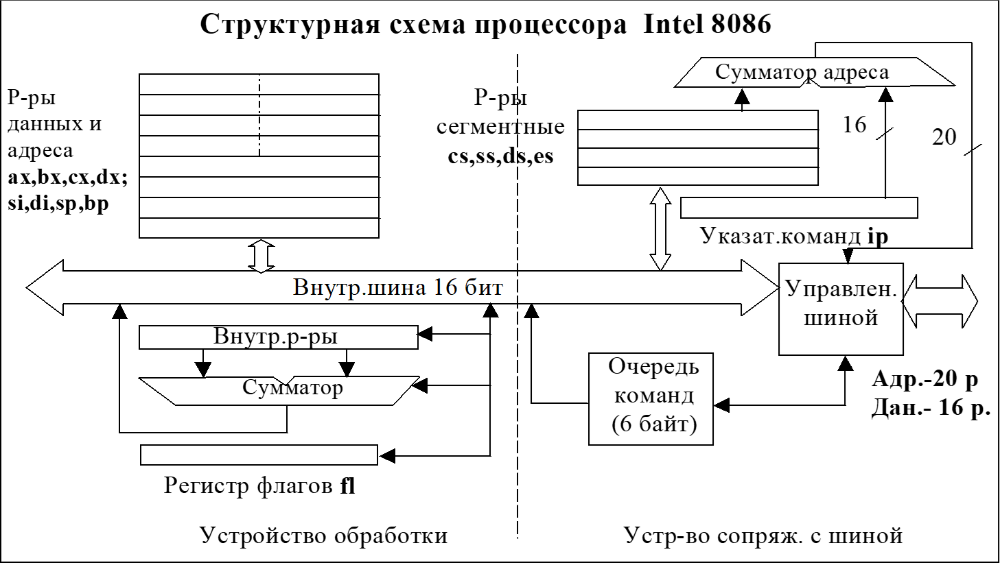

### Регистр флагов

Флаги описывают результаты вычислений и отдельные состояния процессора.

| Флаг | Значение |
| --- | --- |
| `CF` | Перенос |
| `PF` | Чётность |
| `AF` | Вспомогательный перенос |
| `ZF` | Нулевой результат |
| `SF` | Знак |
| `TF` | Режим пошаговой отладки |
| `IF` | Разрешение прерываний |
| `DF` | Направление строковых команд |
| `OF` | Переполнение |

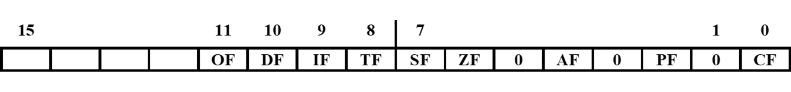

### Конвейер

Пока устройство обработки (УО) исполняет текущую инструкцию, устройство сопряжения с шиной (УСШ) может заранее получить следующую. Это совмещение стадий показано на временной диаграмме.

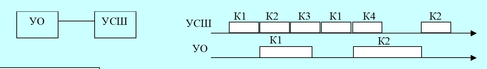

### Сегментная организация памяти

В модели 8086 память адресуется сегментами, для которых используются регистры:

| Регистр | Сегмент |
| --- | --- |
| `CS` | Код |
| `DS` | Данные |
| `SS` | Стек |
| `ES` | Дополнительный сегмент |

Адрес задаётся как **сегмент:смещение**; примеры такой записи — `DS:BX` и `0xB800:0`.

Для описанного способа адресования физический адрес вычисляется так:

    Физический адрес = значение сегментного регистра × 16 + смещение

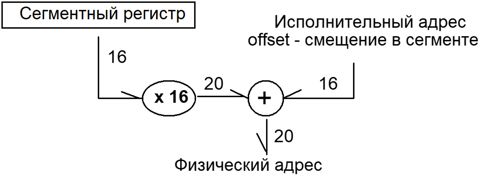

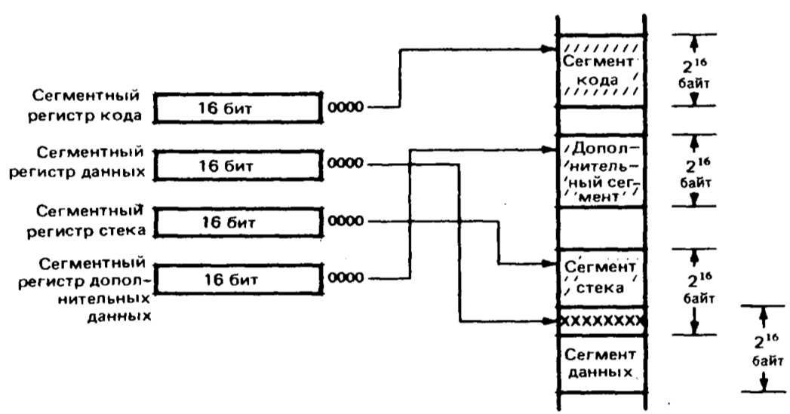

Среди команд для работы с адресами упомянуты `LEA` и `LES`. Там же приведены модели размещения программ Tiny, Small, Medium, Compact, Large и Huge.

## Команды семейства x86

Далее материал переходит от схемы 8086 к набору команд более поздних представителей семейства x86.

В показанных двухоперандных инструкциях один источник — регистр, второй может быть регистром или памятью; результат записывается в регистр либо в память.

Инструкции x86 относятся к классу **CISC**. Для них характерны переменная и непростая структура кодирования, разнообразные режимы адресации и отдельные специализированные команды и регистры.

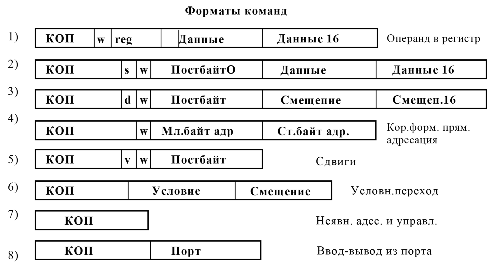

### Команды пересылки

| Команды | Назначение |
| --- | --- |
| `MOV` | Пересылка данных |
| `PUSH, POP` | Запись в стек и извлечение из стека |
| `LDS, LES, LFS, LGS, LSS` | Загрузка адреса и соответствующего сегментного регистра |
| `LEA` | Загрузка эффективного адреса |
| `MOVSB, MOVSW, MOVSD` | Пересылка элементов строки |
| `LODSB, LODSW, LODSD` | Загрузка элемента строки в `AL, AX, EAX` |
| `STOSB, STOSW, STOSD` | Сохранение `AL, AX, EAX` в строку |
| `CMOVcc` | Пересылка при выполнении условия по флагам |
| `BSWAP, XCHG` | Изменение порядка байтов или обмен операндами |
| `IN, OUT` | Обмен с портами периферийных устройств |

Пример чтения из памяти в регистр: `MOV eax, [ebx]`.

В приведённой модели указатель стека `(E)SP` содержит адрес текущего занятого элемента на вершине.

Повторяемая команда `REP MOVSB` выполняет такие действия:

1. Элемент из `DS:[E]SI` пересылается в `ES:[E]DI`.
2. Адреса увеличиваются при `DF = 0` или уменьшаются при `DF = 1`.
3. Счётчик `[E]CX` уменьшается на 1.
4. Пока счётчик не равен нулю, пересылка повторяется.

Сочетание префикса повторения с `STOS` удобно для заполнения области памяти одним и тем же значением.

Системные регистры обслуживают специальные инструкции `LGDT, LIDT, LLDT, RDMSR, SGDT, SIDT, SLDT`.

У `IN` и `OUT` адрес порта можно указать непосредственным значением от 0 до 255 либо передать через `DX`.

### Арифметические команды

| Команды | Действие |
| --- | --- |
| `ADD` | Сложение |
| `ADC` | Сложение с учётом переноса `CF` |
| `SUB` | Вычитание |
| `SBB` | Вычитание с учётом заёма `CF` |
| `CMP` | Сравнение вычитанием, результат не сохраняется, флаги изменяются |
| `NEG` | Смена знака |
| `INC, DEC` | Увеличение или уменьшение на 1 |
| `MUL, DIV` | Умножение и деление беззнаковых чисел |
| `IMUL, IDIV` | Умножение и деление чисел со знаком |

Инструкции `INC` и `DEC` оставляют `CF` без изменения. Примеры умножения и деления также используют операнды удвоенной ширины.

### Логические команды

| Команды | Действие |
| --- | --- |
| `OR` | Побитовое ИЛИ, позволяет устанавливать выбранные биты |
| `AND` | Побитовое И, позволяет сбрасывать выбранные биты |
| `XOR` | Исключающее ИЛИ, позволяет инвертировать выбранные биты |
| `TEST` | Проверка битов с изменением флагов |
| `NOT` | Инвертирование всех битов операнда |
| `BSF, BSR` | Поиск единичного бита и получение его номера |
| `BT, BTC, BTR, BTS` | Проверка выбранного бита с записью его значения во флаг |

Многие инструкции обработки обновляют часть флагов. Указанные команды передачи данных, напротив, не меняют признаки результата.

### Сдвиги

Количество позиций для сдвига задают единицей, значением регистра `CL` или непосредственной константой.

| Команды | Вид сдвига |
| --- | --- |
| `ROL, ROR` | Циклический: вышедший бит возвращается с другого конца |
| `RCL, RCR` | Циклический с участием флага `CF` |
| `SAL, SAR` | Арифметический; при сдвиге вправо сохраняется знаковый бит |
| `SHL, SHR` | Логический; освободившиеся позиции заполняются нулями |
| `SHLD, SHRD` | Сдвиг двойного слова |

Арифметический сдвиг в примерах используется как способ умножения или деления на степень двойки.

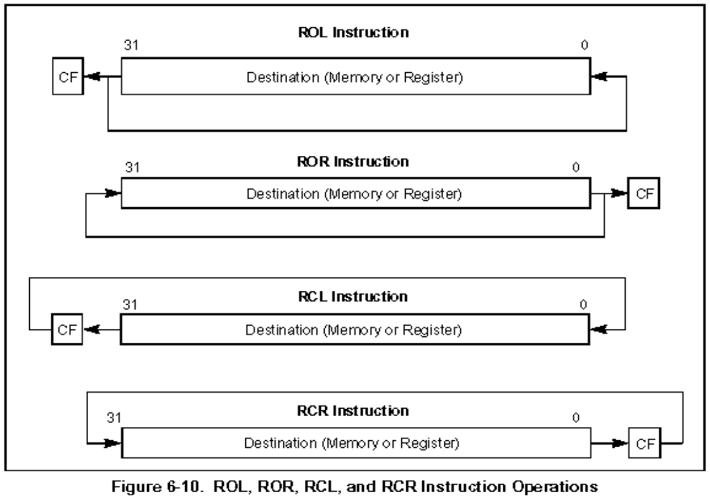

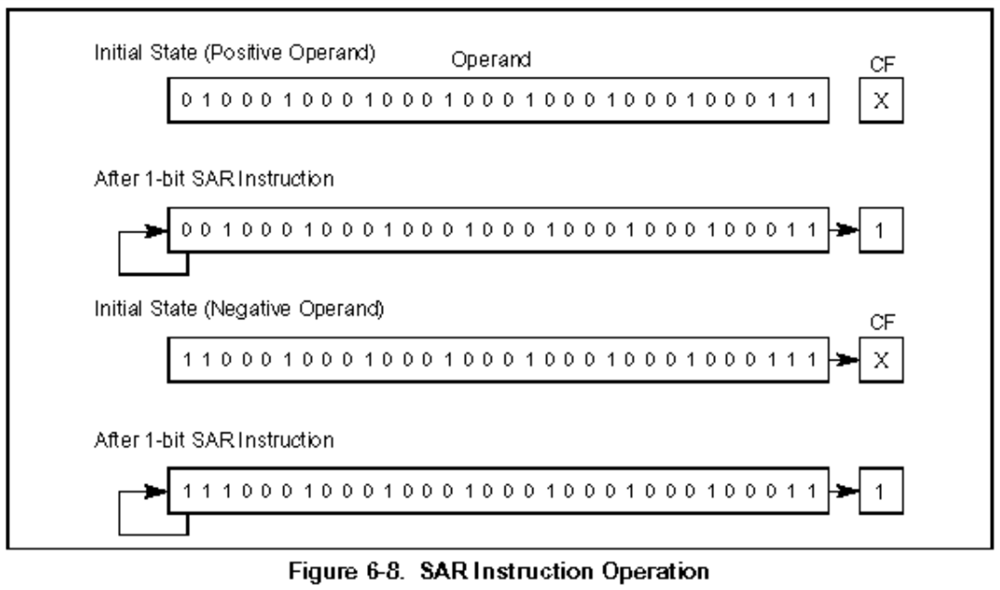

### Проверки и передача управления

- `CMP` сопоставляет два операнда, `CMPS` проверяет элементы строк, а `SCAS` сравнивает элемент строки с `AL`, `AX` или `EAX`.
- Семейство `Jcc` выполняет переход при условии по флагам: например, `JC` реагирует на установленный `CF`, а `JNZ` — на нулевой `ZF`.
- `LOOP` повторяет тело цикла, используя `[E]CX` как счётчик.
- Безусловную передачу управления выполняет `JMP`.
- `CALL` сохраняет возврат и передаёт управление процедуре, `RET` завершает её и возвращает выполнение.
- `ENTER` формирует стековый кадр, а `LEAVE` снимает его.

## Кодирование команд и адресация

В материале приведена следующая общая раскладка двухоперандной инструкции:

    [Префикс] КОП [Постбайт адресации] [Смещение] [Непосредственный операнд]

Поля в квадратных скобках добавляются только тогда, когда они требуются выбранной инструкцией.

**КОП** определяет выполняемое действие. Постбайт адресации кодирует регистры и метод обращения к операндам. Префикс может выбрать другой сегмент, повторить строковую операцию, установить блокировку либо изменить размер адреса или значения.

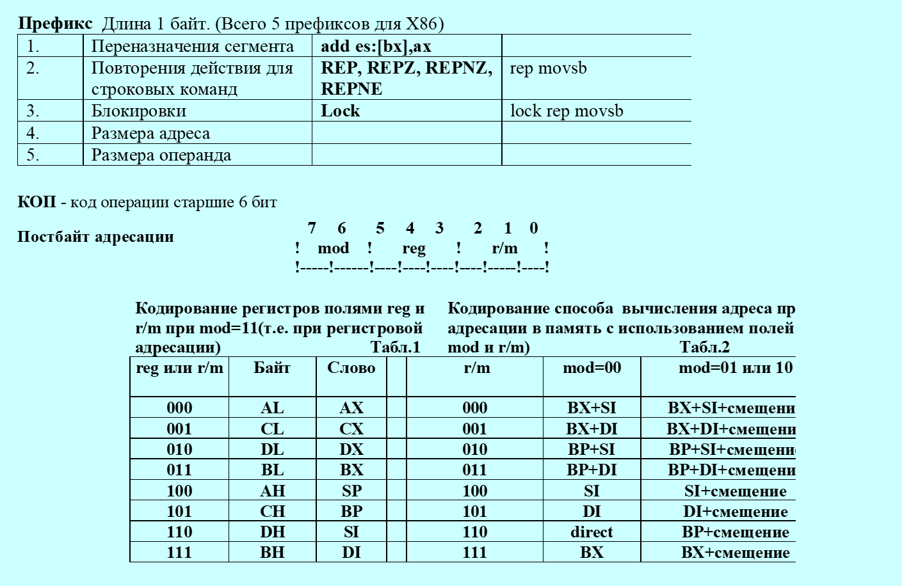

Расширенная адресация может включать байт **SIB** с полями масштаба, индексного и базового регистров.

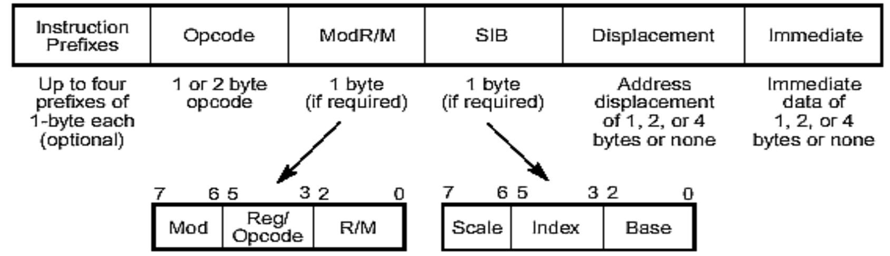

Пример из презентации:

    ADD [eax + 2*ebx], ecx
    00000001  00 001 100  01 011 000

Эффективное смещение складывается из содержимого базового или индексного регистра и значения `disp`. Затем оно прибавляется к началу сегмента для получения адреса.

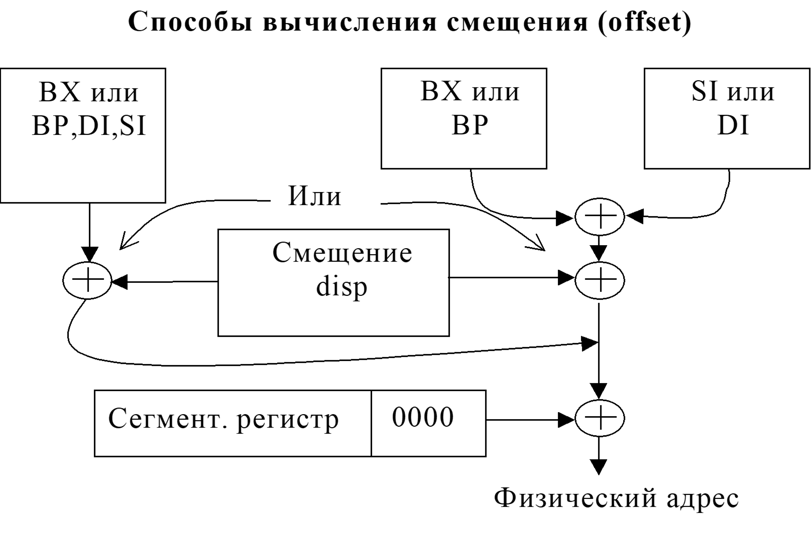

### Адресное пространство и память IBM PC

Диаграммы для реального режима показывают, где располагаются таблица векторов, данные BIOS, пользовательские программы и данные, видеопамять и области ПЗУ.

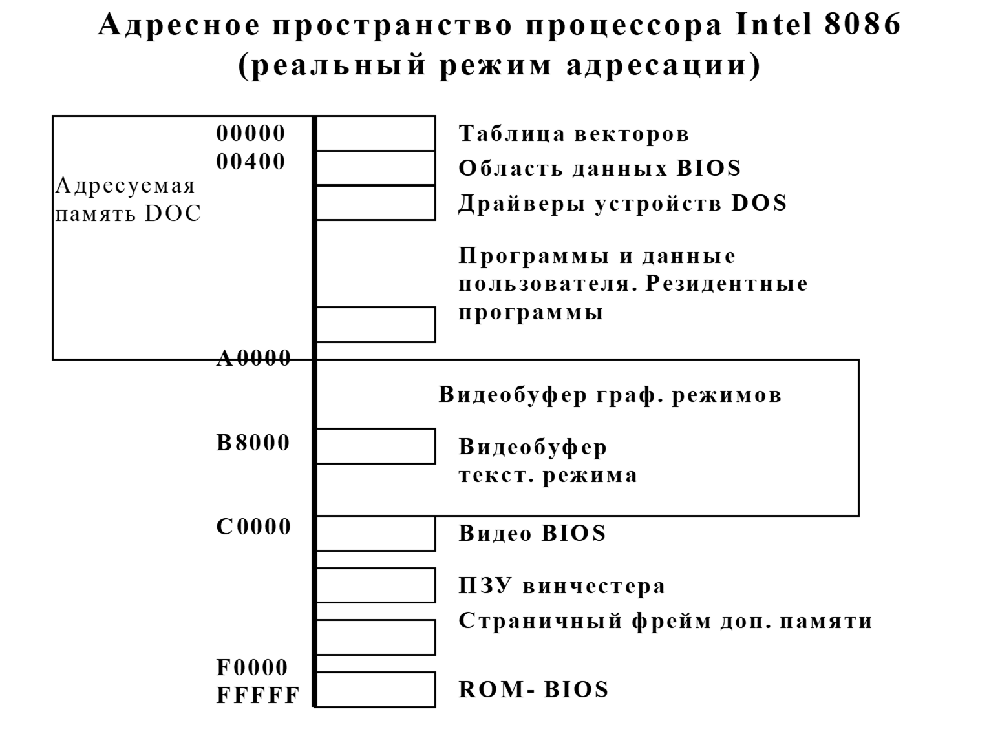

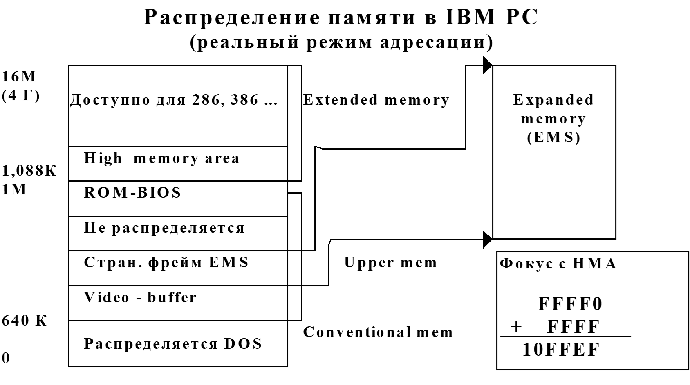

В схемах используются следующие сокращения:

- **EMS** — expanded memory, организация расширяемой памяти с использованием окна.
- **XMS** — стандарт управления extended memory.
- **UMB** — блоки верхней памяти.
- **Shadow RAM** — копирование данных из медленного ПЗУ в более быстрое ОЗУ.

В примерах для DOS приведены менеджеры памяти `EMM386.EXE`, `QEMM`, драйвер `HIMEM.SYS` и параметры `DOS=HIGH`, `DOS=HIGH,UMB`.

## Подпрограммы и контекст

В презентации сравниваются два способа структурирования программы:

- **Макроподстановка**: текст фрагмента подставляется на этапе компиляции.
- **Подпрограмма**: во время выполнения программа передаёт управление отдельному фрагменту, обменивается с ним данными и затем возвращается.

**Контекст программы** — значения, которые нужно сохранить и восстановить, чтобы продолжить её выполнение:

- счётчик команд и регистр флагов;
- остальные регистры процессора;
- указатели стеков;
- указатели адресного пространства задачи;
- переменные и промежуточные результаты.

### Вызов и возврат

Команда `CALL` или `JSR` как минимум:

1. Сохраняет адрес возврата — адрес команды после вызова.
2. Загружает в счётчик команд адрес первой команды подпрограммы.

Команда `RET` или `RTS` возвращает управление вызывающей программе.

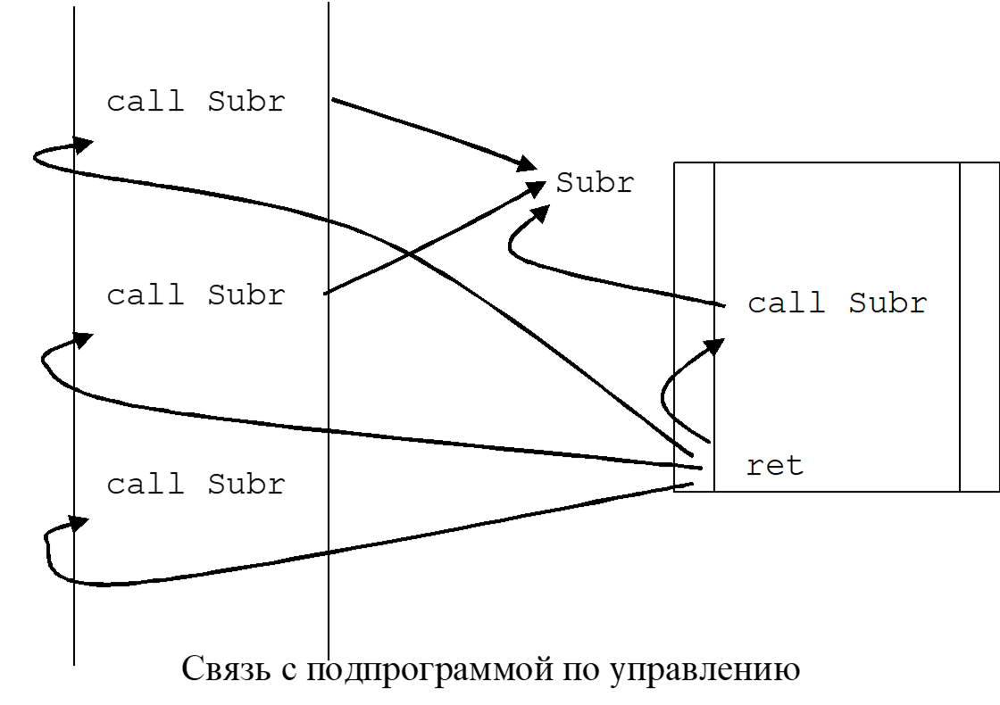

Вложенные вызовы позволяют одной подпрограмме обращаться к другой. В приведённом примере `main` вызывает `proc1`, она вызывает `proc2`, а та — `proc3`.

Для каждого вызова нужен свой адрес возврата. На схемах показано, какие данные сохраняются в стеке при ближнем и дальнем вызовах и извлекаются при возврате.

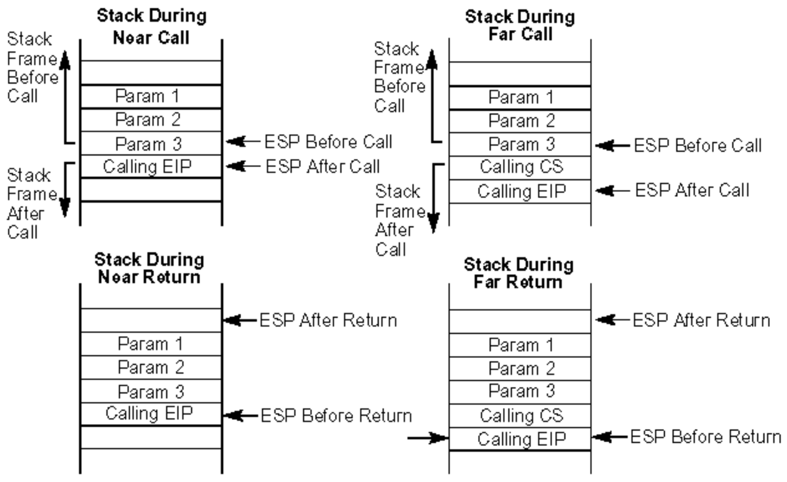

### Сохранение и восстановление контекста

В разных процессорах эта задача решается по-разному:

- специальными командами, например `PUSHA` и `POPA` в x86;
- несколькими наборами регистров;
- рабочими областями в памяти, как в примере TMS9900;
- стековой организацией регистров;
- динамическим переименованием регистров, как в примере IA-64.

Для примера сохранения регистров x86 приведена последовательность `(E)AX, (E)CX, (E)DX, (E)BX, (E)SP, (E)BP, (E)SI, (E)DI`. В стек помещается значение `(E)SP`, существовавшее перед началом этой операции.

### Передача данных

Аргументы процедуры передают непосредственно либо передают указатель на область, где они размещены.

Способы передачи:

- через регистры;
- через стек;
- через заранее оговорённое место памяти.

Пример функции из презентации:

    int addition(int x, int y) {
        int iX, iY;
        iX = 2*x + y;
        iY = 3*y - x;
        return iX*iY;
    }

В таблице дизассемблирования прослеживаются сохранение `BP`, формирование кадра, чтение аргументов и локальных переменных, вычисление возвращаемого значения и выход из процедуры.

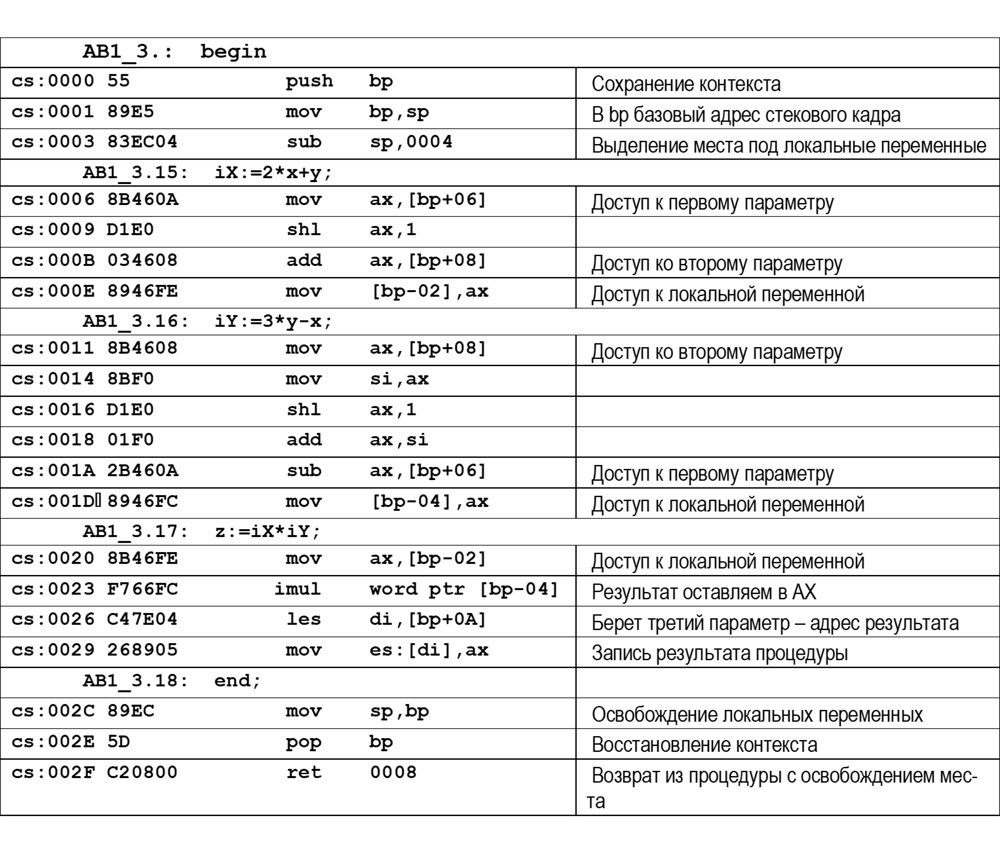

### Стековый кадр

**Стековый кадр** — часть стека, выделенная на время конкретного вызова процедуры.

На схеме кадра обозначены:

- ссылка на предыдущий кадр — динамическая связь;
- таблица указателей на ранее созданные кадры — индикатор;
- локальные переменные.

Базовый указатель `BP` помогает обращаться к полям текущего кадра, а `SP` показывает текущее положение вершины стека.

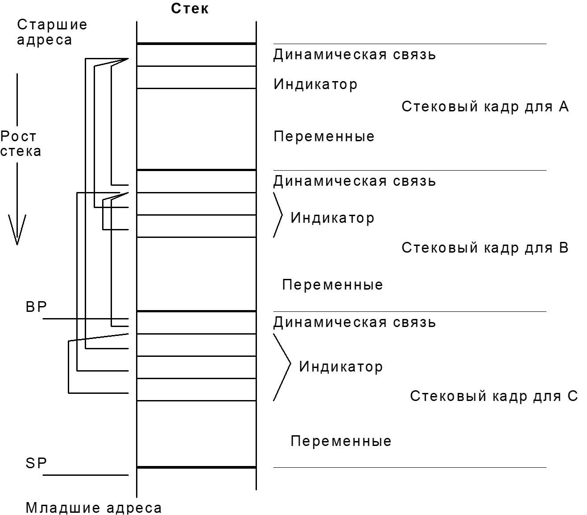

Инструкция `ENTER frmsiz, level` подготавливает кадр следующим образом:

- `frmsiz` задаёт объём в байтах, резервируемый под локальные переменные;
- `level` определяет глубину вложенности при построении индикатора кадров.

Последовательность шагов в рассматриваемом примере:

1. Запомнить `SP` во временном регистре.
2. Поместить старое значение `BP` в стек.
3. Скопировать нужные ссылки из предыдущего кадра.
4. Добавить ссылку на новый кадр.
5. Установить `BP` на начало создаваемого кадра.
6. Уменьшить `SP` на `frmsiz`, выделив место для локальных переменных.

`LEAVE` убирает текущий кадр, после чего `RET` возвращает выполнение вызывающему коду.
