# Выполнение машинной команды

Конспект о том, как процессор получает команду и данные, выполняет операцию и передаёт результат.

## Программа, данные и команды

**Программа** состоит из команд, которые обрабатывают входные данные и формируют результат. Их исполняет процессор; в данной модели и команды, и данные размещаются в **оперативной памяти (ОП)**.

Связь процессора с памятью обеспечивается системной шиной, состоящей из линий данных, адреса и управляющих сигналов.

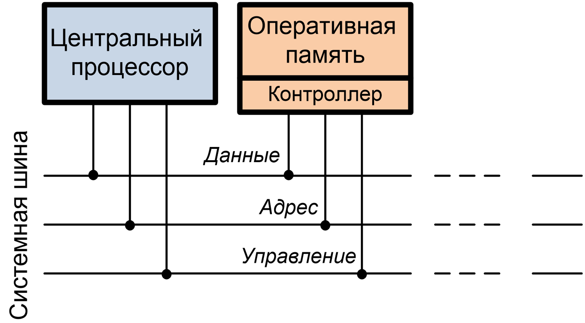

### Представление данных

- Числовые значения кодируются битами: с фиксированной либо плавающей точкой.
- Текстовые знаки также сопоставляются двоичным кодам.
- Битовый вектор — упорядоченный набор разрядов, к которому применимы логические операции над отдельными позициями.

В иллюстрируемом формате старший разряд служит знаком: `0` указывает на плюс, `1` — на минус.

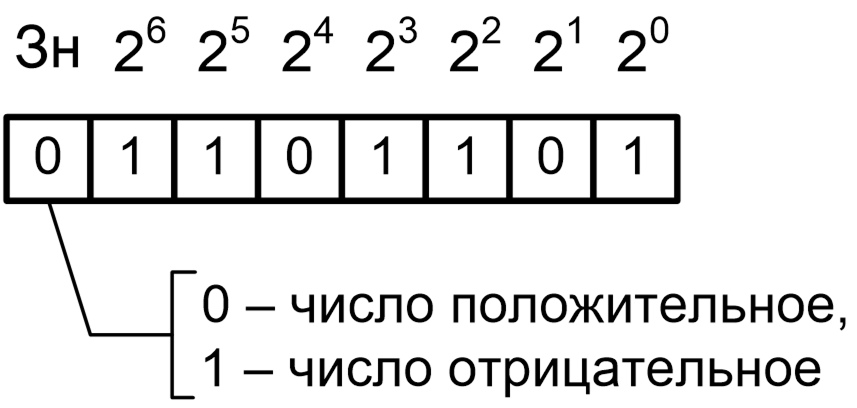

Пример на слайде:

    1101101₂ = 1 + 4 + 8 + 32 + 64 = 109₁₀

### Представление команд

**Команда** определяет действие, которое предстоит выполнить процессору.

В разобранном двухадресном формате присутствуют три поля:

1. **КОП** указывает, какую операцию выбрать.
2. **A₁** задаёт место первого операнда.
3. **A₂** задаёт место второго операнда.

В данном формате результат заменяет значение по адресу первого операнда.

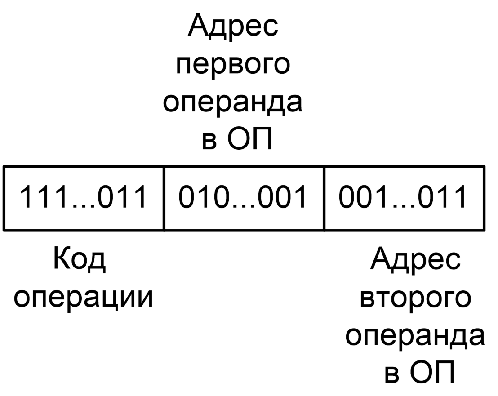

**Система команд процессора** описывает все операции, доступные его программам. Среди них арифметика, логика, передача данных, изменение хода программы и ввод-вывод.

На иллюстрации показана часть набора инструкций микроконтроллера КМ1816ВЕ51.

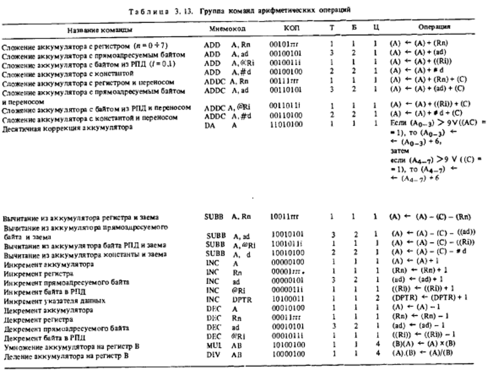

## Устройства и регистры

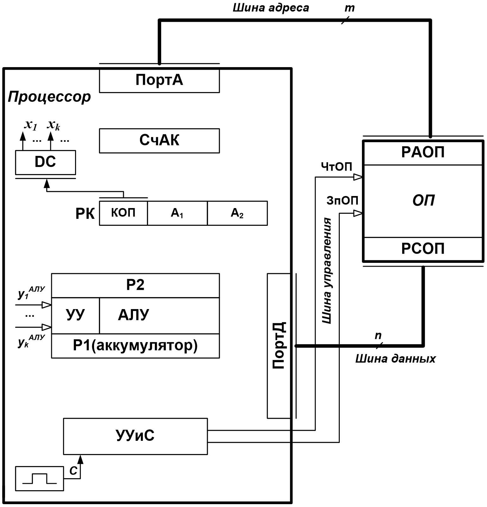

Назначения условных обозначений:

| Обозначение | Назначение |
| --- | --- |
| **УУиС** | Блок управления и синхронизации, координирующий остальные узлы |
| **СчАК**, **СК**, **PC** | Счётчик команд, указывающий адрес следующей инструкции |
| **РК** | Регистр текущей команды на время её обработки |
| **ПортА** | Интерфейс процессора с адресной шиной |
| **ПортД** | Интерфейс с шиной данных |
| **Р1** | Аккумулятор АЛУ: принимает первый операнд и хранит итог |
| **Р2** | Регистр для второго операнда АЛУ |
| **РАОП** | Буфер адреса оперативной памяти |
| **РСОП** | Буфер слова, читаемого из ОП или записываемого в неё |
| **DC** | Узел декодирования кода операции |
| **C** | Источник тактовых импульсов |

Ширина СчАК должна соответствовать длине адреса, а ёмкость РК — максимальному размеру инструкции. Разрядность регистров АЛУ выбирают по ширине операнда; порты рассчитаны на ширину соответствующих шин.

### Чтение из ОП

Чтение из ОП выполняется в таком порядке:

1. Адрес требуемой ячейки передаётся на адресную шину и сохраняется в РАОП.
2. Процессор активирует управляющий сигнал **ЧтОП**.
3. Память помещает считанное слово в РСОП, откуда оно поступает через шину данных в ПортД.

### Запись в ОП

Для записи значения в память нужны следующие действия:

1. Адрес ячейки устанавливается на адресной шине и заносится в РАОП.
2. Записываемое слово передаётся по шине данных в РСОП.
3. Выдаётся сигнал **ЗпОП**, запускающий запись.

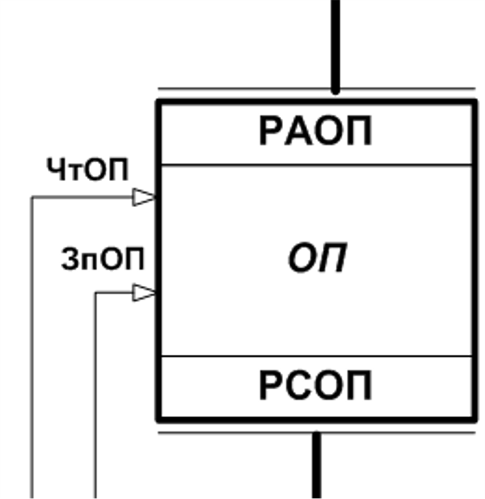

## Пять этапов рабочего цикла

Далее рассматривается арифметическая либо логическая инструкция с двумя адресами операндов.

Её рабочий цикл можно разделить на пять стадий:

1. Прочитать команду из оперативной памяти.
2. Получить значения обоих операндов.
3. Выполнить заданное вычисление в АЛУ.
4. Сохранить результат обратно в ОП.
5. Переместить счётчик команд к следующей инструкции.

В схемах `y₁, y₂, …` обозначают управляющие линии, а `x₁, x₂, …` — сигналы состояния. Запись `РК := ПортД` означает, что данные из ПортД загружаются в РК.

### 1. Выборка команды

| Шаг | Сигнал | Действие |
| --- | --- | --- |
| 1 | `y₁` | `ПортА := СчАК` |
| 2 | `y₂` | `ЧтОП` |
| 3 | `y₃` | `РК := ПортД` |

Сначала процессор указывает адрес инструкции. Память передаёт её через шину данных, после чего команда фиксируется в РК.

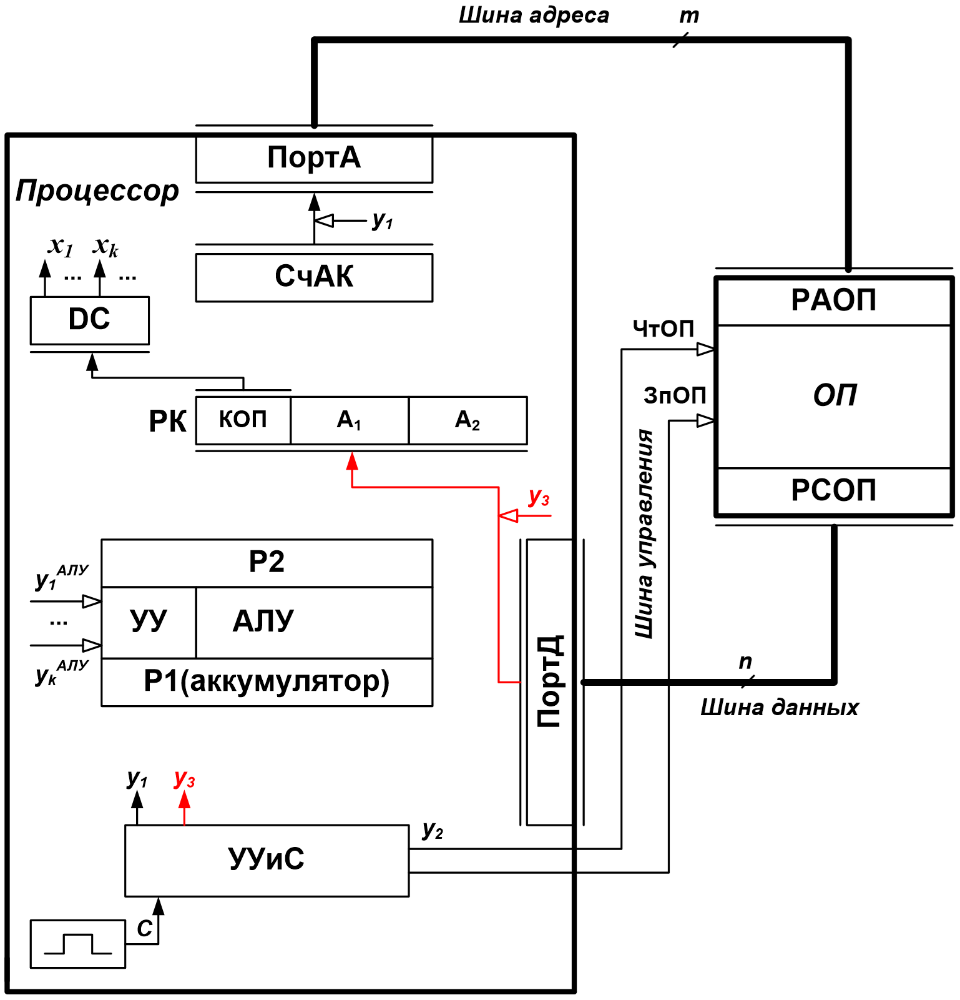

### 2. Выборка операндов

Первый операнд:

| Шаг | Сигнал | Действие |
| --- | --- | --- |
| 4 | `y₄` | `ПортА := A₁` |
| 5 | `y₂` | `ЧтОП` |
| 6 | `y₅` | `Р1 := ПортД` |

Из РК извлекается адрес первого аргумента. Прочитанное значение поступает из ОП в аккумулятор Р1.

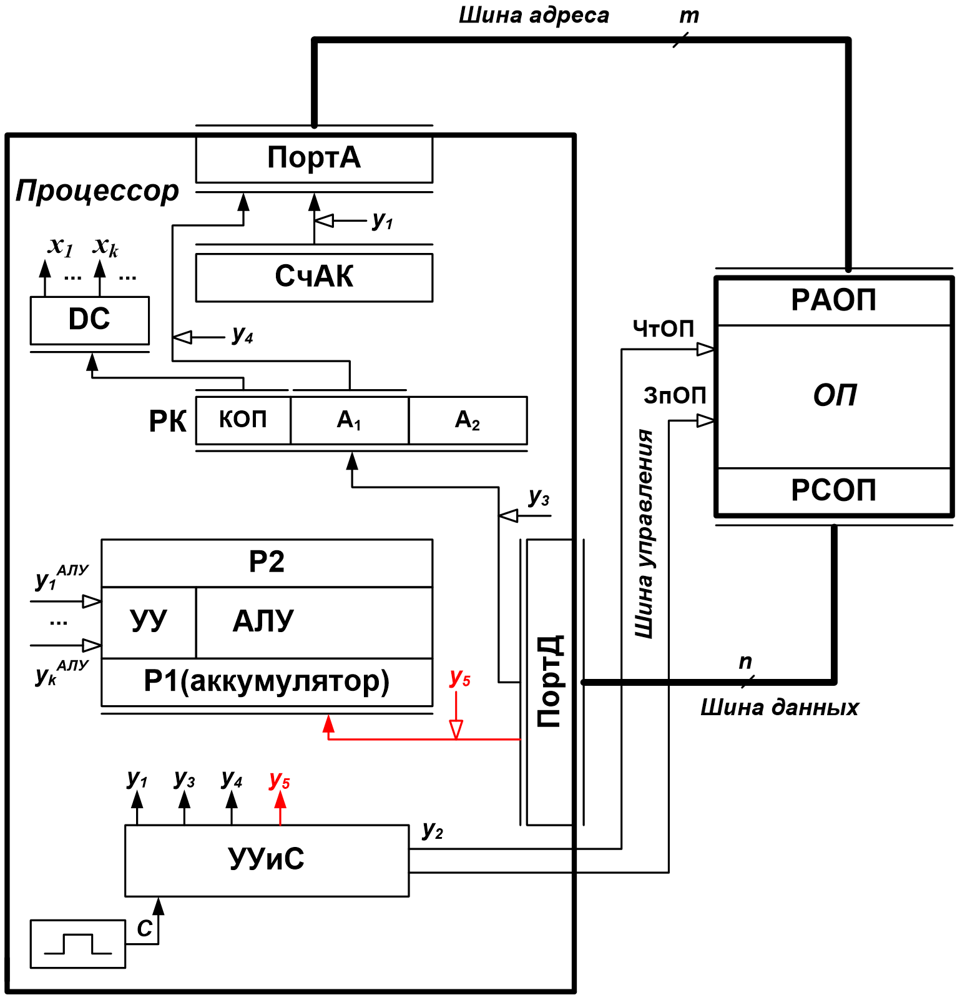

Второй операнд:

| Шаг | Сигнал | Действие |
| --- | --- | --- |
| 7 | `y₆` | `ПортА := A₂` |
| 8 | `y₂` | `ЧтОП` |
| 9 | `y₇` | `Р2 := ПортД` |

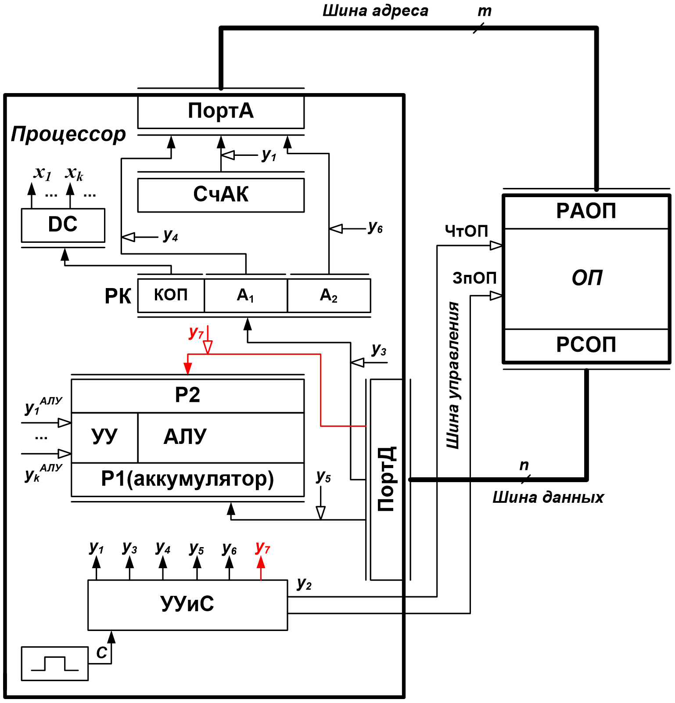

### 3. Выполнение операции в АЛУ

На шаге 10 поле операции из РК передаётся дешифратору DC.

После распознавания команды на соответствующей линии появляется `xᵢ = 1`. В ответ УУиС подаёт сигнал `yᵢАЛУ`, запускающий нужное действие АЛУ.

Завершённое вычисление оставляет результат в Р1.

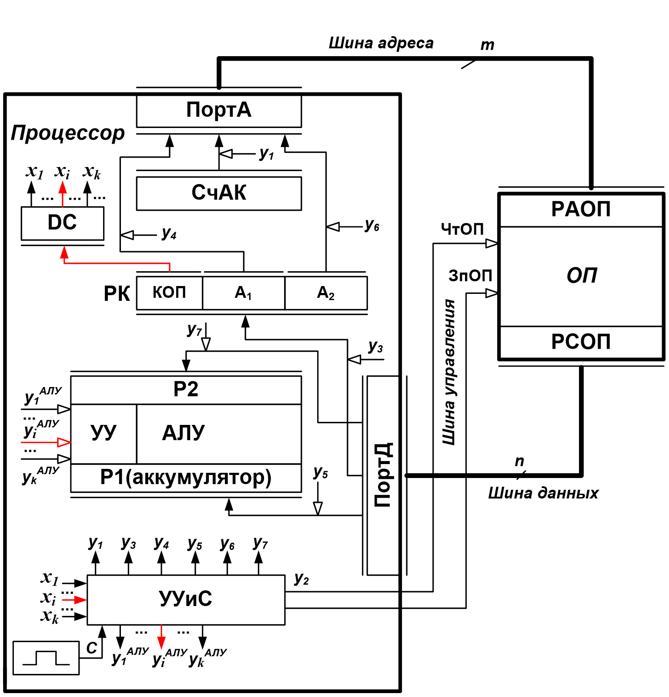

### 4. Запись результата

| Шаг | Сигнал | Действие |
| --- | --- | --- |
| 11 | `y₈` | `ПортД := Р1` |
| 12 | `y₄` | `ПортА := A₁` |
| 13 | `y₉` | `ЗпОП` |

Значение из Р1 выводится на линию данных, а адрес A₁ — на адресную шину. Затем память заменяет прежний первый операнд вычисленным результатом.

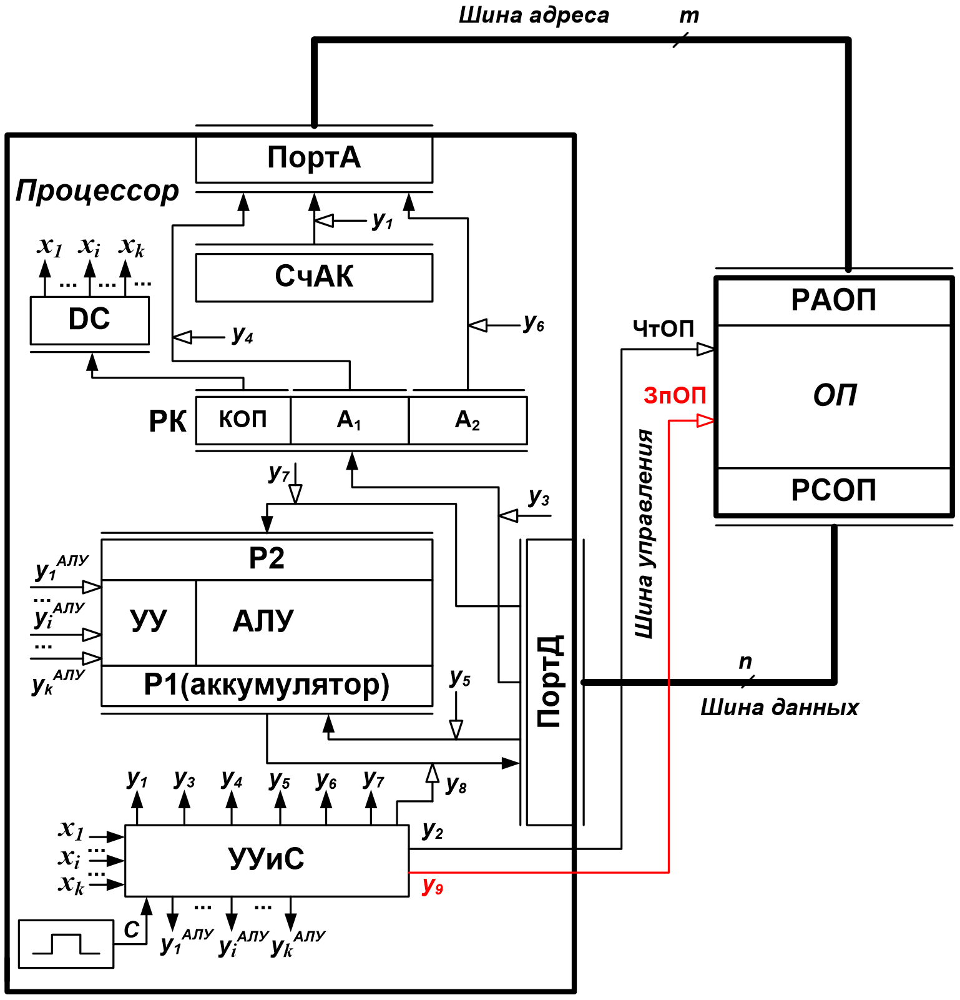

### 5. Продвижение счётчика команд

На четырнадцатом шаге:

    y₁₀: СчАК := СчАК + L

Здесь **L** — число байтов в обработанной инструкции. После прибавления СчАК содержит адрес следующей команды.

Обновить счётчик можно сразу после того, как команда прочитана.

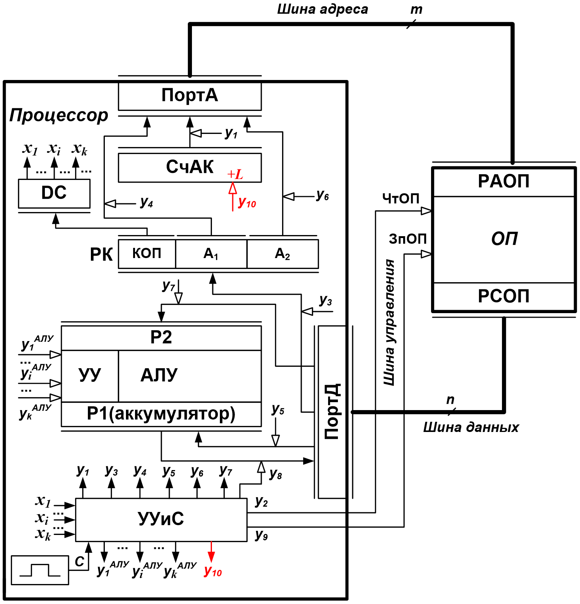

## Начало работы процессора

Упрощённая модель использует внешние линии **Set** и **Reset**, чтобы соответственно включить и остановить УУиС.

При запуске УУиС подаёт `y₀` и загружает стартовый адрес программы в СчАК.

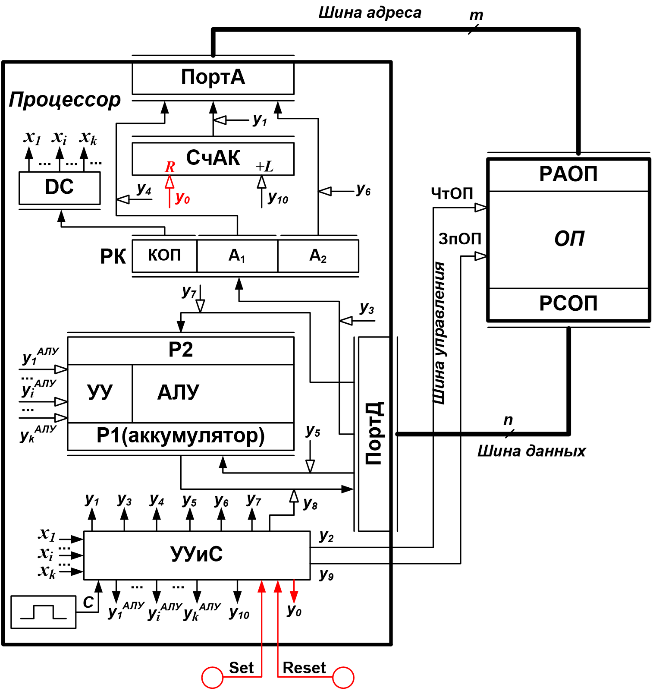

На условном графическом обозначении процессора присутствуют:

- линии адреса `A` и данных `D`;
- контакты питания и земли;
- вход синхронизации;
- сигналы `RD` и `WR` для операций с оперативной памятью;
- линии `IN` и `OUT` для взаимодействия с периферией.

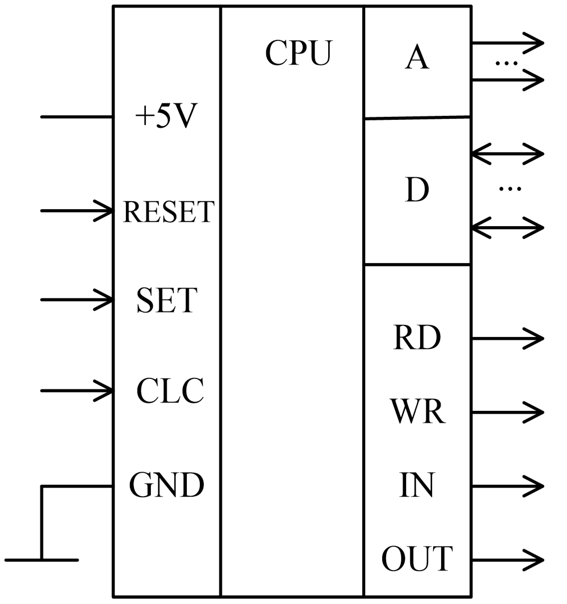

УУиС вновь проходит последовательность управляющих сигналов для каждой команды. При поступлении прерывания между инструкциями выполняется соответствующая обработка.

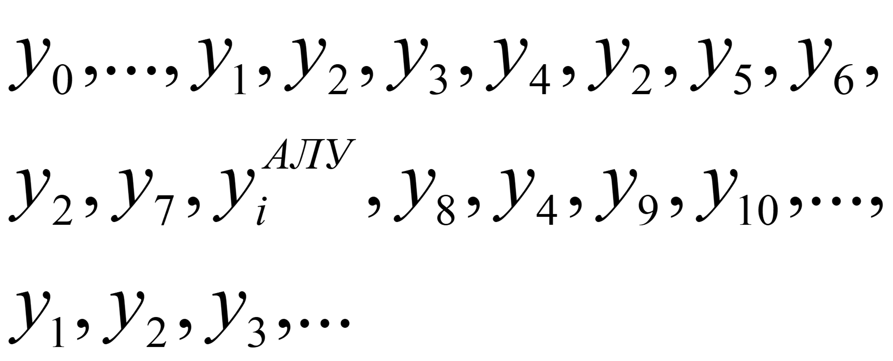

## Пошаговый пример сложения

Для пошагового примера приняты следующие параметры:

- Набор включает 256 инструкций, поэтому поле КОП имеет ширину 8 бит.
- В инструкции записаны адреса обоих операндов.
- ОП организована побайтно, и адрес назначен каждой ячейке-байту.
- Ширина шины данных равна 32 битам, что позволяет за обращение передать от одного до четырёх байтов.
- Восьмиразрядная адресная шина задаёт `2⁸ = 256` адресов байтов.
- Инструкции и значения размещаются в одной памяти, то есть используется принстонская модель.
- Каждый операнд занимает два байта; его адресом считается адрес первого байта.

### Выборка команды

Изначально СК содержит `00110110₂ = 54₁₀`.

Трёхбайтовая инструкция начинается по адресу 54 и состоит из таких частей:

| Поле | Двоичное значение | Значение |
| --- | --- | --- |
| КОП | `11011101` | Код операции сложения в примере |
| A₁ | `01110110` | Адрес первого операнда: 118 |
| A₂ | `01111000` | Адрес второго операнда: 120 |

Процессор обращается к адресу 54, читает все поля инструкции и помещает их в РК.

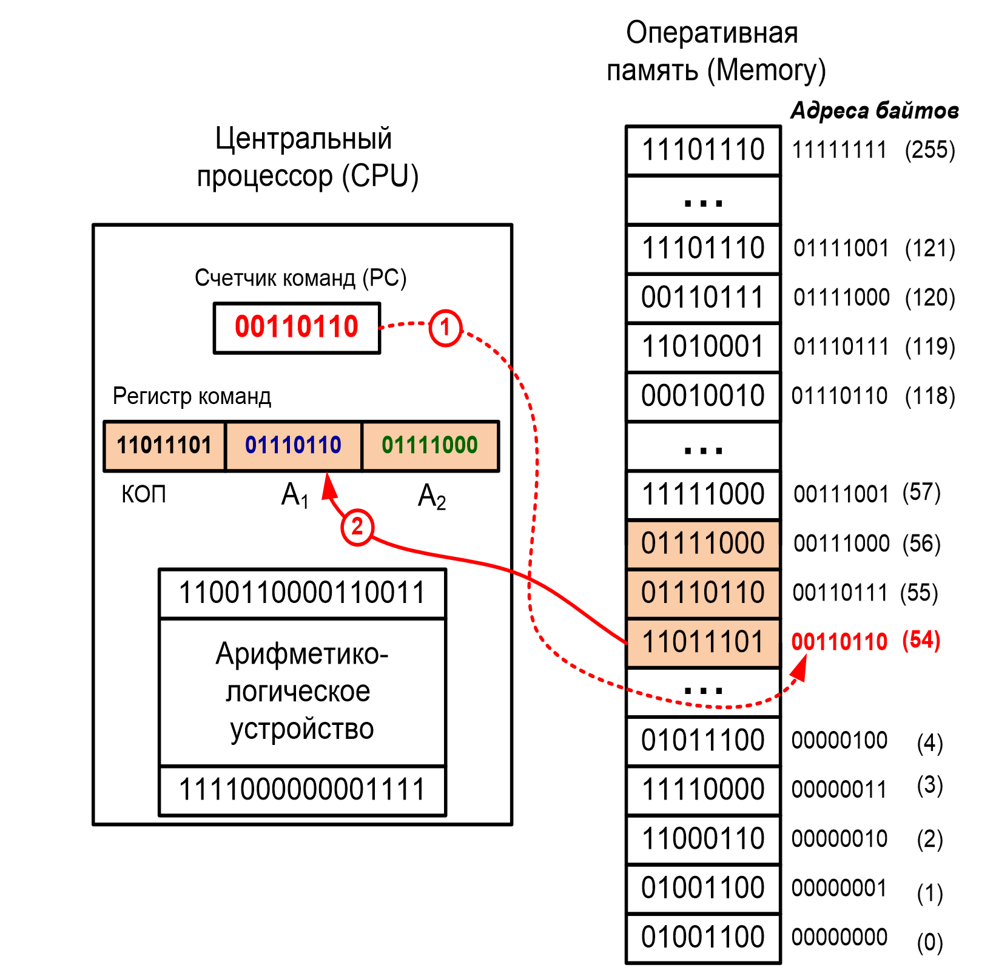

### Выборка данных и сложение

Первое двухбайтовое значение читается из ячеек 118–119 и загружается в Р1. Второе берётся из байтов 120–121 и попадает в Р2.

Значения в регистрах на схеме:

    Р1 = 0001001011010001₂
    Р2 = 0011011111101110₂

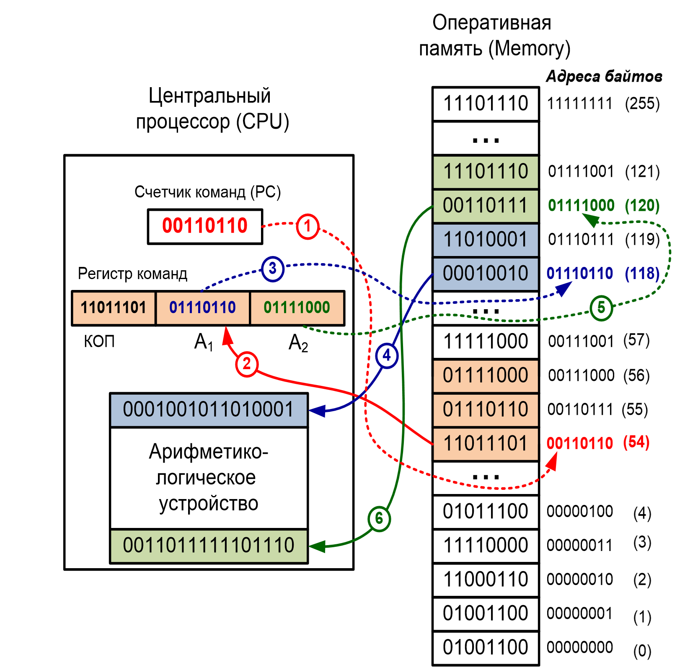

Затем АЛУ складывает эти значения:

    0001001011010001
    0011011111101110
    ----------------
    0100101010111111

Полученная сумма записывается в аккумулятор Р1.

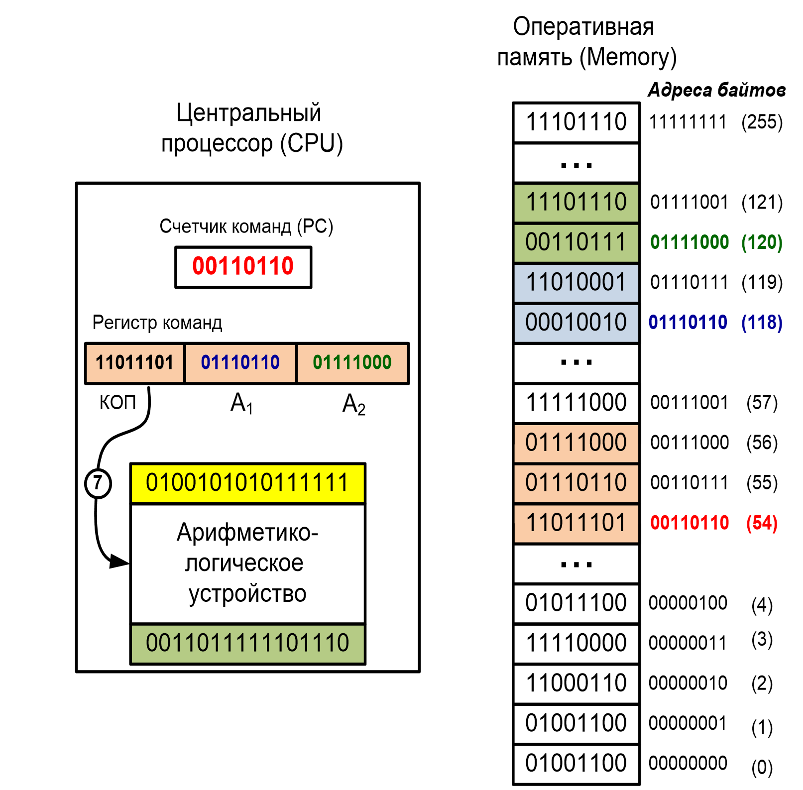

### Запись и следующая команда

Сумма сохраняется в оперативной памяти по адресам 118 и 119, заменяя первый аргумент.

СК увеличивается на длину команды:

    СК := 54 + 3 = 57
    СК = 00111001₂

Далее процессор начинает новый цикл с инструкции, расположенной по адресу 57.

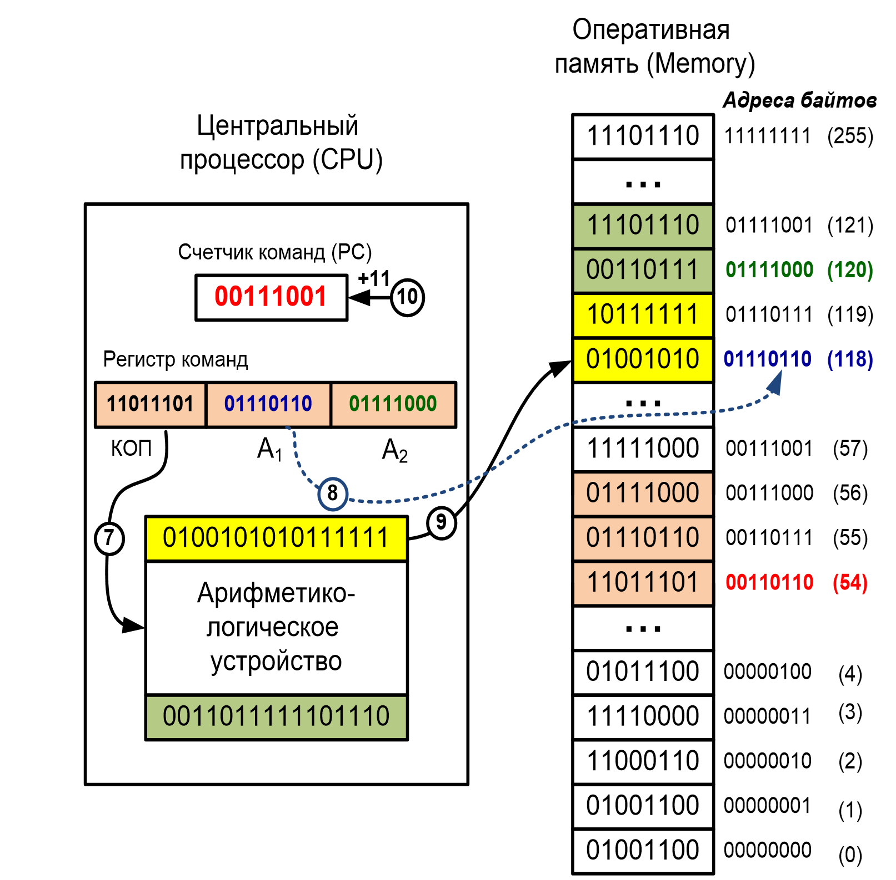

## Завершение операции и признаки результата

Расширенная схема АЛУ показывает не только итоговые биты, но и линии признаков, ошибок и состояния «занято/свободно».

В состав процессора для этих сигналов вводятся дополнительные регистры:

- **РПР** — двухбитовый регистр, хранящий категорию результата;
- **РФ** — регистр, в котором фиксируются флаги исключений и прерываний.

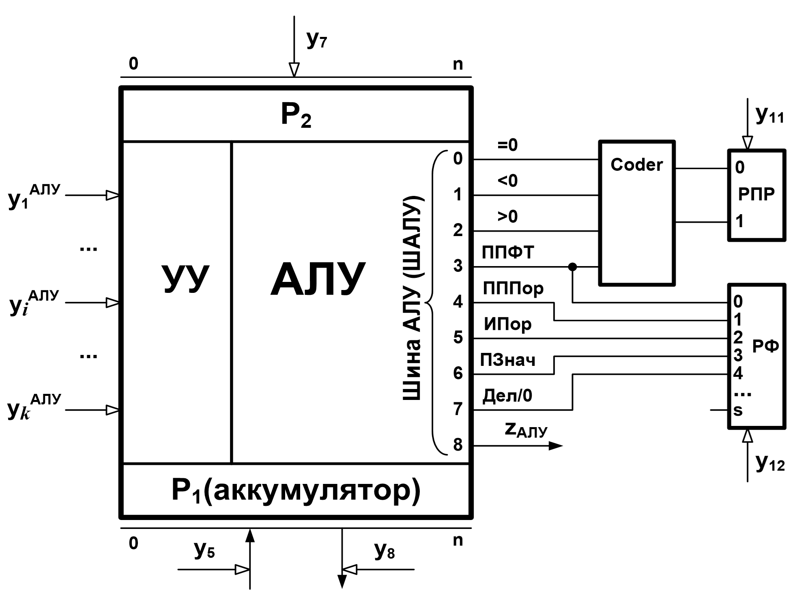

### Сигнал «занято/свободно»

Начав вычисление, АЛУ выставляет `ZАЛУ = 1`, сигнализируя о занятости.

Процессор ждёт сброса сигнала в `ZАЛУ = 0`. После этого вычисление считается завершённым, значение доступно в Р1 и его можно сохранять.

В схеме признак занятости передаётся по линии **ШАЛУ(8)**.

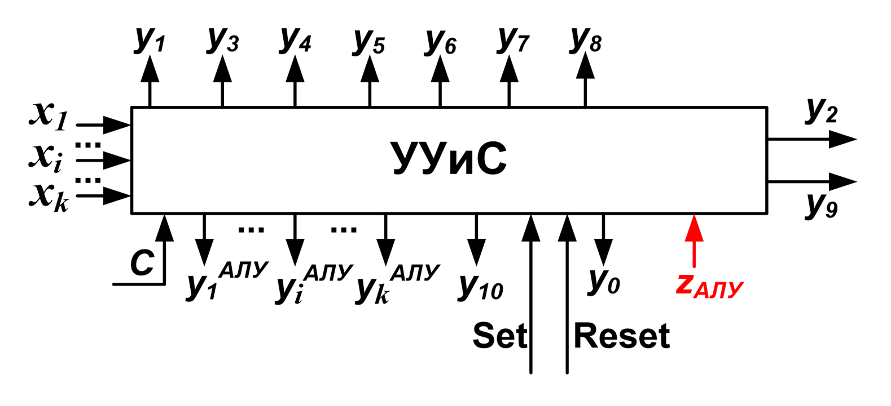

### Код признака результата

После `add, sub, inc, dec, and, or, xor` АЛУ выдаёт один из четырёх сигналов унитарного кода. Блок **Coder** преобразует выбранную линию в двухбитовую запись РПР.

| Линия ШАЛУ | Признак | Код в РПР |
| --- | --- | --- |
| `ШАЛУ(0)` | Результат равен нулю | `00` |
| `ШАЛУ(1)` | Результат меньше нуля | `01` |
| `ШАЛУ(2)` | Результат больше нуля | `10` |
| `ШАЛУ(3)` | Переполнение с фиксированной точкой | `11` |

### Флаги исключительных ситуаций

Помимо категории результата, устройство может сообщить о следующих исключительных состояниях:

- переполнения с фиксированной точкой;
- переполнения порядка;
- исчезновения порядка;
- потери значимости;
- деления на ноль.

Соответствующие биты записываются в РФ, чтобы процессор мог обработать событие прерыванием.

В структурной схеме деление на ноль передаётся линией **ШАЛУ(7)**, занятость — **ШАЛУ(8)**. В подписи к одному слайду для деления на ноль указан номер 8; здесь оставлено обозначение с самой схемы.

### Уточнение этапа записи результата

Запись итога в память сопровождается также следующими действиями:

    y₈:  ПортД := Р1
    y₁₁: РПР(0:1) := Coder(ШАЛУ(0:3))
    y₁₂: РФ(0:4) := ШАЛУ(3:7)
    y₄:  ПортА := A₁
    y₉:  ЗпОП

РПР обновляется только при выполнении перечисленных арифметических и логических инструкций; остальные команды не меняют его значения.

Набор `ШАЛУ(3:7) = 00000` означает, что ни одно исключительное событие не зафиксировано.

В РФ предусмотрено больше разрядов, чем генерирует АЛУ, поскольку запросы могут приходить от таймера и внешних устройств.

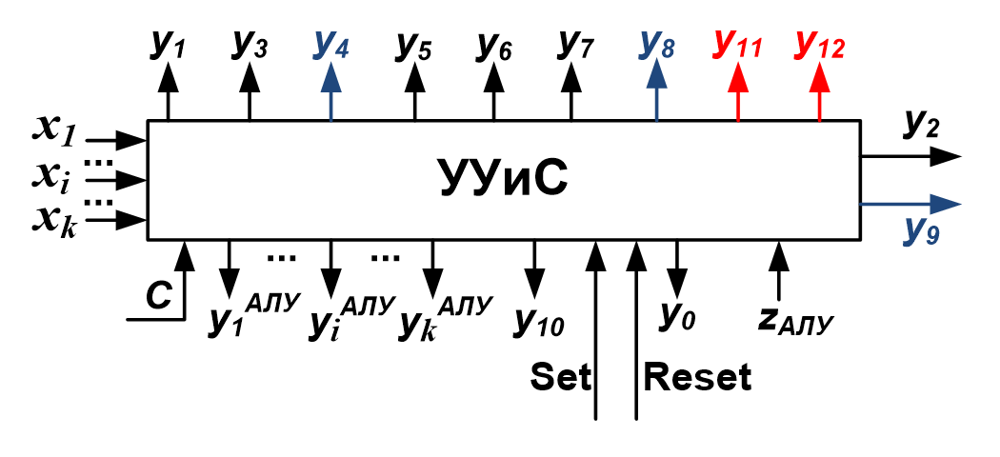

## Команды перехода

Обычная арифметическая или логическая инструкция завершается переходом СК к следующему адресу.

Для выбора другого адреса, ветвления или повторения участка программы служат **команды управления потоком**.

### Условный переход по маске

Формат команды в рассматриваемом примере:

| Поле | Разряды РК | Назначение |
| --- | --- | --- |
| КОП | `0:7` | Код операции |
| M | `8:11` | Маска перехода |
| A | `12:n` | Адрес перехода |

Маска задаёт, при каких категориях результата условие перехода считается истинным.

| Код РПР | Бит маски | Условие |
| --- | --- | --- |
| `00` | `РК(8)` | Результат равен нулю |
| `01` | `РК(9)` | Результат меньше нуля |
| `10` | `РК(10)` | Результат больше нуля |
| `11` | `РК(11)` | Переполнение с фиксированной точкой |

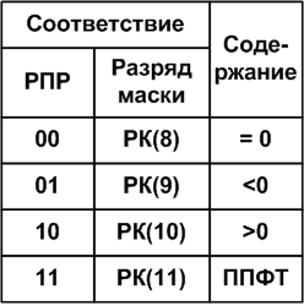

Логика проверки выполняется так:

1. Нулевая маска `M = 0000` всегда отменяет переход.
2. Нулевой адрес `A = 0` тоже означает отсутствие перехода.
3. При `M = 1111` и ненулевом A выполняется безусловный переход.
4. Для остальных масок выбирается бит, соответствующий текущему значению РПР.
5. Если выбранный бит установлен, A загружается в СчАК; иначе берётся следующая команда.

Адресная часть СчАК увеличивается после чтения команды перехода. Если условие выполнено, это значение заменяется на A; РПР остаётся прежним.

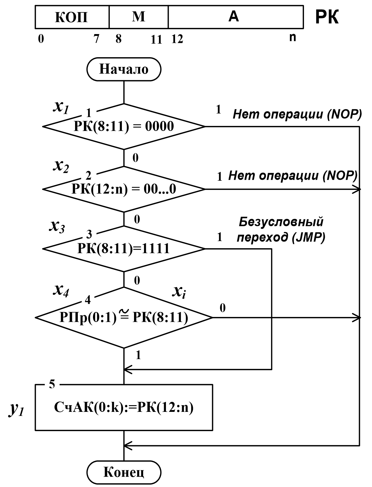

### Схема проверки условия

На структурной схеме состояния кодируются так:

- `x₁` сообщает, что маска состоит из нулей;
- `x₂` отмечает нулевой адрес перехода;
- `x₃` означает, что маска заполнена единицами;
- `x₄` показывает, разрешает ли маска текущий признак результата.

Когда условие подтверждено, `y₁` переносит адрес из РК в СчАК. Обозначения сигналов относятся именно к этой схеме.

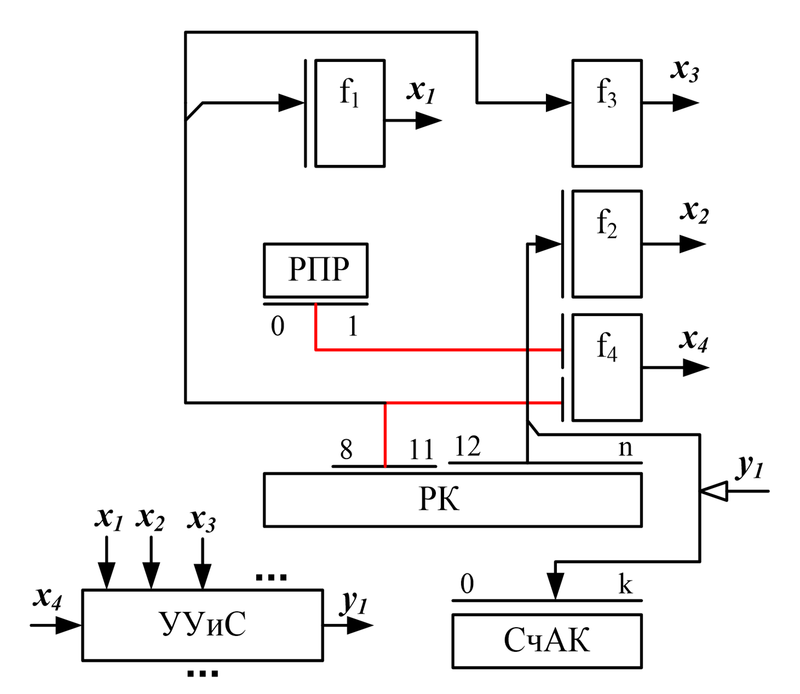

Чтобы получить `x₄`, дешифратор по РПР выбирает один из четырёх статусов. Каждый статус проверяется вместе со своим битом маски через элемент И, а результаты объединяются элементом ИЛИ.

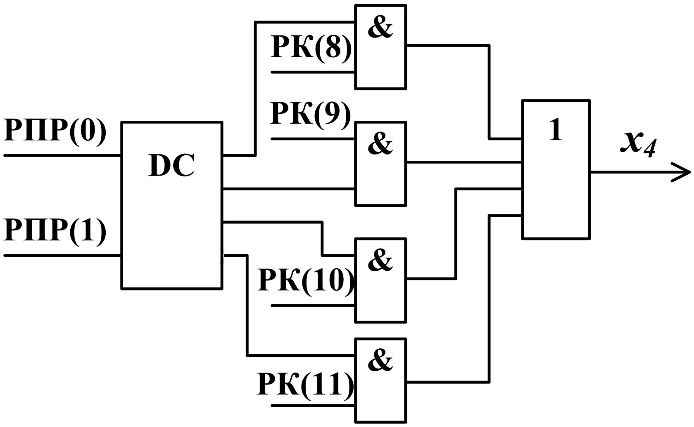

Если память содержит `EОП = 2ᴺ` байтов, количество разрядов адреса определяется выражением:

    N_A = log₂(EОП)

Ту же ширину имеют СчАК и поле A. Следовательно, для адресации 256 байтов достаточно восьми бит.

## Прерывания и переключение программ

При **прерывании** процессор приостанавливает текущий код, запускает обработчик события, а затем возобновляет прежнюю программу.

### Источники прерываний

1. **Ошибки вычислений**: например, деление на ноль, переполнение, исчезновение порядка или потеря значимости.
2. **Периферия**: запросы устройств ввода-вывода и нажатия клавиш.
3. **Таймер**: периодические сигналы для передачи процессора другой программе.

Примером внешнего события служит клавиша `Num Lock`: обработчик переключает индикатор, а затем выполнение основной программы продолжается.

**Маска прерываний** позволяет временно запретить отдельные запросы, хотя часть событий остаётся немаскируемой.

### Мультипрограммный режим

Каждая программа получает ограниченный **временной квант**. В качестве примера указан интервал `τ = 1/30 с`.

По окончании кванта таймер вызывает прерывание: процессор начинает выполнять другую программу. При следующем переключении первая продолжит работу с сохранённой позиции.

### Регистры флагов и масок

- **РФ** отмечает уже возникшие запросы и исключения.
- **РМ** содержит настройки разрешённых и запрещённых запросов.

За каждым источником закреплён отдельный разряд. В этой схеме единица в соответствующей позиции РМ блокирует маскируемое прерывание.

## Таблица векторов прерываний и стек

В описанной модели начальные `n` слов памяти отведены под **таблицу векторов прерываний (ТВП)**.

Для каждого типа прерывания выделена запись таблицы с командой, безусловно передающей управление обработчику по адресу Aᵢ.

Адрес продолжения сохраняется в **стеке**, вершину которого отслеживает **указатель стека (УС)**.

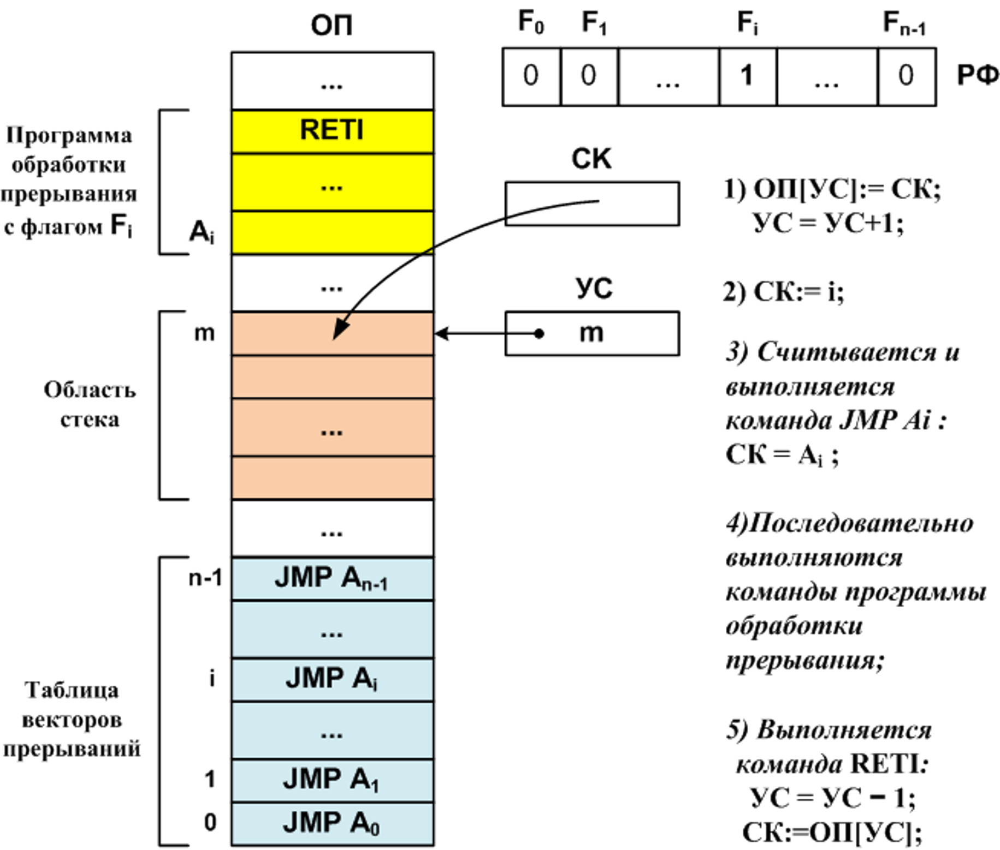

Стек подчиняется правилу **LIFO**: последняя сохранённая величина будет получена первой.

В данной модели УС хранит адрес свободной ячейки на вершине:

- при добавлении значение записывается в `ОП[УС]`, после чего УС сдвигается вперёд;
- при извлечении сначала уменьшают УС, а затем читают `ОП[УС]`.

### Последовательность обслуживания прерывания

По завершении инструкции процессор анализирует РФ. Если найден установленный флаг `Fᵢ = 1`, не запрещённый маской, выполняется следующий порядок:

1. В стек помещается СК, уже указывающий на команду продолжения:

        ОП[УС] := СК
        УС := УС + 1

2. Счётчик получает адрес записи таблицы, относящейся к запросу:

        СК := i

3. Из этой записи выполняется переход к процедуре обработки:

        JMP Aᵢ
        СК := Aᵢ

4. Управление выполняет код обработчика.
5. Инструкция `RETI` завершает обработку и восстанавливает адрес продолжения:

        УС := УС - 1
        СК := ОП[УС]

Затем процессор возвращается к прерванной программе.

При нескольких установленных флагах порядок обслуживания определяется принятыми приоритетами или последовательностью опроса. Обрабатываются активные запросы, не закрытые маской.

### Сохранение состояния программы

В рассмотренном варианте аппаратно сохраняется только адрес возврата.

Если обработчик использует регистры, чьи значения нужны основной программе, он должен сохранить их при входе и восстановить перед `RETI`. Это может относиться к РПР, специальным регистрам и РОН.

Некоторые процессоры автоматически сохраняют вместе с адресом и другие регистры. Совокупность такого состояния называют **словом состояния программы (ССП, PSW)**.
